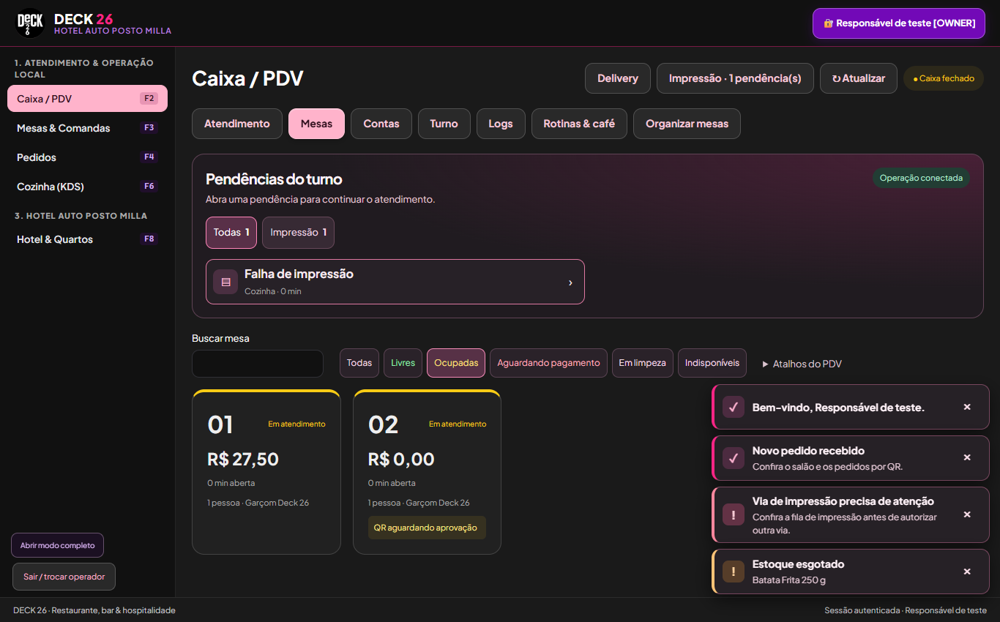
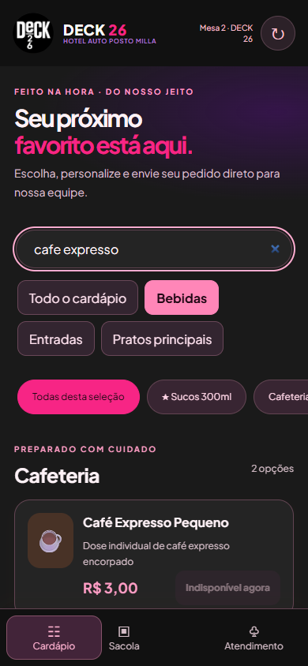
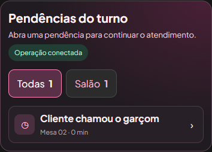
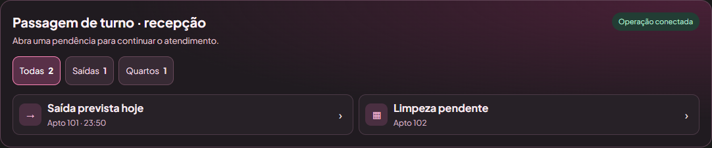
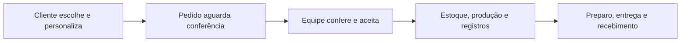
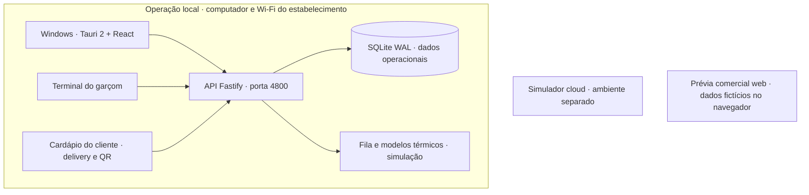

<div align="center">


# DECK 26 · Gestão & Hospitalidade

**Restaurante, bar, delivery e hotel conectados à mesma operação local.**

Um caixa mais prático. Uma recepção mais organizada. Pedidos chegando pelo celular.<br>
Dados persistentes no computador do estabelecimento, com acesso pela rede Wi-Fi.

[](https://github.com/Duailibe32/deck26-system/actions/workflows/ci.yml)
[](https://github.com/Duailibe32/deck26-system/actions/workflows/windows-test.yml)


[Conhecer o sistema](#experiencia) · [Novidades](#novidades) · [Começar no Windows](#windows) · [Acessar pelo celular](#celular) · [Checklist](#checklist) · [Documentação](#documentacao)

</div>

---

> **Entrega de 11/11/2026 · Atendimento mobile, PDV Windows e continuidade**<br>
> Aplicativo Windows nativo, operação em rede local e **252 testes automatizados aprovados** na validação local. Consulte a [compilação para Windows](#windows), o [roteiro de teste](#checklist) e o [estado das integrações](#limites).

<a id="experiencia"></a>

## ✨ Uma operação, várias formas de atender

O DECK 26 reúne o atendimento do **Restaurante e Bar Deck 26** e a recepção do **Hotel Auto Posto Milla**. As telas se organizam por função: o garçom atende mesas, o caixa recebe, a recepção cuida das hospedagens e a gerência acompanha os resultados.

<table>
<tr><td width="50%" valign="top">

### 🍽️ Restaurante & bar

Mesas por situação, favoritos, observações rápidas, carrinho em formato de cupom, divisão da conta, troco touch e transferência de consumo para o quarto.

</td><td width="50%" valign="top">

### 🛎️ Hotel & recepção

Reservas em calendário, check-in, extrato do quarto, check-out, pernoite, day use, café incluso, estacionamento e manutenção programada.

</td></tr>
<tr><td width="50%" valign="top">

### 🛵 Delivery & autoatendimento

Cardápio responsivo, personalização, entrega ou retirada, taxas por região e pedidos sujeitos à conferência da equipe. QR da mesa para pedir e chamar atendimento.

</td><td width="50%" valign="top">

### 📊 Estoque & gestão

Fichas técnicas, combos, produção interna, compras por fornecedor, alertas de margem, convênios, contas a receber, dashboard e trilha de auditoria.

</td></tr>
</table>

### A interface na prática

<p align="center">
  <br>
  <sub>Caixa Windows · mapa, filtros, pendências e avisos da operação.</sub>
</p>

<table>
<tr>
<td width="34%" align="center" valign="top">
  <br>
  <strong>Cliente no celular</strong><br><sub>Cardápio, sacola e atendimento pelo QR.</sub>
</td>
<td width="66%" align="center" valign="top">
  <br>
  <strong>Garçom no celular</strong><br><sub>O chamado abre direto no atendimento da mesa.</sub><br><br>
  <br>
  <strong>Recepção Hotel Milla</strong><br><sub>Saídas e quartos que exigem atenção.</sub>
</td>
</tr>
</table>

<sub>Capturas com dados fictícios. Veja também o [painel gerencial](docs/images/windows-dashboard.png) e o [calendário do hotel](docs/images/calendario-hotel.png).</sub>

<a id="novidades"></a>

## 🆕 Novidades desta entrega

| Experiência | O que foi entregue |
| --- | --- |
| **Cardápio e pedidos pelo celular** | Menu inferior, filtros de **Bebidas, Entradas e Pratos principais**, busca por nome ou descrição que aceita termos sem acento, personalização, sacola persistente na sessão e acompanhamento de pedidos online. |
| **Terminal do garçom** | Menu **Mesas · Lançar · Chamados · Mais**, acesso direto ao chamado e confirmação antes de descartar itens ao trocar de mesa. O envio fica vinculado à comanda original. |
| **PDV Windows** | Mapa por situação, gaveta que abre na ação da mesa, conferência do saldo e abas de resumo, histórico, transferências, cancelamentos e hotel. |
| **Pendências e avisos do turno** | Caixa, garçom e recepção veem pendências conforme o perfil. Toasts avisam sobre pedidos recebidos, estoque no mínimo ou esgotado e falhas de impressão. |
| **Fechamento de caixa** | Conferência de dinheiro contado, PIX e cartão registrados. O sistema exige justificativa quando o dinheiro contado diverge do saldo esperado e revalida o saldo ao fechar. |
| **QR, impressão e backup** | QR escaneável e baixável por mesa, PDF A4 de plaquinhas, fila de impressão com filtros e autorização de 2ª via. Diagnóstico da operação e ensaio de recuperação em cópia isolada. |
| **Demonstração web** | Horário de pico com mesas e hospedagens fictícias, além de resumo para copiar no WhatsApp. |

[Cardápio da demonstração](docs/images/cardapio-demo-mobile.png) · [Fila de impressão](docs/images/fila-impressao.png) · [Conferência do fechamento](docs/images/conferencia-turno.png)

<a id="funcionalidades"></a>

## 🧩 Funcionalidades por área

| Área | O que está disponível |
| --- | --- |
| **PDV & mesas** | Visão por função; modos simplificado/completo para gerência; subabas; mesas com cores, tempo e alerta sem pedido; gaveta de ações; busca e favoritos; teclado touch; cupom lateral; recebimentos parciais e divisão por pessoa. |
| **Garçom & QR** | Terminal Wi-Fi com PIN; abertura de mesa; observações prontas e texto livre; acompanhamentos; aprovação de pedidos QR; chamar garçom e pedir conta; transferência ao quarto com confirmação por PIN autorizado. |
| **Restaurante** | Promoções por dia e horário; executivos com escolhas obrigatórias configuráveis; baldes com baixa das unidades individuais; couvert separado; consumo interno da equipe com baixa de estoque. |
| **Cozinha & comprovantes** | Fluxo em papel sem necessidade de TV; fila por estação; entrega confirmada pela equipe; modelos de cozinha, pré-conta, pagamento e fechamento em 58/80 mm; simulação HTML e impressão/PDF pelo navegador. |
| **Delivery** | Pedidos pelo cliente, entrega/retirada, personalização, taxa e mínimo por área; aceite antes da produção; status operacionais; previsão considerando região e fila; repetição do último pedido por telefone na estação autorizada; entregadores e acerto de custódia. |
| **Hotel / PMS** | Reservas em linha do tempo; quartos disponíveis/ocupados; check-in, folio e check-out; diária, pernoite com valor informado e day use de 4/6 horas; alerta de vencimento; café e vouchers; veículos; manutenção recorrente e bloqueios programados. |
| **Estoque & compras** | Inventário; receitas; baixa de insumos; produção/porcionamento com balanço de massa; fornecedores; lista de reposição para copiar ou imprimir; alertas de margem e preço sugerido aplicado mediante confirmação. |
| **Financeiro & empresas** | Caixa e turno; contas a pagar/receber; conciliação gerencial; DRE; convênios com limite; faturas quinzenais/mensais sem entrada fictícia de dinheiro; resumo para copiar no WhatsApp. |
| **Gestão & acesso** | Dashboard responsivo com Recharts; vendas e ocupação; cargos e permissões; logs com operador e horário; backups; autenticação por PIN e sessão. |

**As cores ajudam; os textos confirmam.** 🟢 Livre · 🟡 Ocupada · 🔴 Aguardando pagamento/chamado · 🔵 Limpeza · ⚪ Indisponível. A identidade combina rosa `#F72585`, preto `#111111`, roxo `#7209B7` e tons neutros, com áreas de toque amplas.

O cadastro inicial inclui **93 produtos e 24 apartamentos, dos quais 12 estão ativos para operação**. A atualização preserva a numeração real e as unidades em construção. Preços, tarifas, saldos e permissões precisam ser revisados pelo responsável.

### Estoque mais fácil e cardápio com fotos

Busca por nome/código, filtros de reposição, unidade real e ações de entrada, saída e contagem no cartão. A contagem recebe o total encontrado, calcula a diferença e confere o saldo antes de gravar. Reenvios não duplicam o lançamento.

A gerência pode adicionar fotos locais em **Estoque → Fotos do cardápio**. O cliente escolhe **Entrega / Retirada** por botões amplos. Na expedição, solicitações sem aceite têm meta, destaque e som opcional.

Veja o [registro e as evidências](docs/MELHORIAS_ESTOQUE_CARDAPIO_20261106.md), o [checklist em texto](docs/CHECKLIST_ESTOQUE_CARDAPIO.md) e a [versão interativa](docs/CHECKLIST_ESTOQUE_CARDAPIO.html).

### Delivery com expedição visual

Pedidos em colunas com tempo por etapa e destaque de atraso, agenda semanal, exceções, pausa temporária, sugestões opcionais no carrinho, CEP assistido, acompanhamento por identificador secreto e etiqueta de embalagem. A conclusão apresenta conferência explícita do recebimento.

Consulte o [registro completo e evidências](docs/MELHORIAS_DELIVERY_20261106.md) e o [checklist específico de delivery](docs/CHECKLIST_DELIVERY.md). O atalho de WhatsApp abre a mensagem para revisão; não há envio automático.

<a id="windows"></a>

## 🖥️ Começar no Windows

### Para quem já tem o aplicativo instalado

1. Abra o atalho **DECK 26 - Operacao Local** na área de trabalho.
2. Entre com seu **PIN pessoal existente**.
3. Confira caixa, estoque, tarifas e funcionários antes do atendimento.
4. Em **Administração → Acesso e continuidade**, consulte os links atuais dos celulares e as opções de backup.

**Não existe PIN operacional padrão.** Em uma instalação nova, o primeiro acesso no PC permite criar o proprietário com PIN de 6 a 12 dígitos e importar o catálogo inicial. Vendas, hóspedes e saldos começam vazios; estoque inicial zerado exige inventário.

### Instalar pelo pacote do GitHub

1. Abra a [Release estável do DECK 26](https://github.com/Duailibe32/deck26-system/releases/latest).
2. Em **Assets**, baixe **DECK26-Instalador.exe**.
3. No Windows x64, abra o instalador com internet disponível. Ele usa o Node.js e o npm incluídos no pacote, instala as dependências do lockfile e prepara o WebView2 se estiver ausente.
4. Abra **DECK 26 - Operacao Local** pela área de trabalho. Em uma instalação nova, cadastre o proprietário. Para atualizar uma base existente, faça backup e confira a pasta de dados antes de abrir a nova versão.

O assistente mostra a versão, a pasta do aplicativo e a pasta dos dados. Cada versão fica em uma pasta própria. Se houver uma base nessa pasta de dados, o instalador verifica um backup consistente antes de ativar a atualização.

### Atualizar pelo GitHub

- No menu Iniciar do Windows, abra **DECK 26 → Verificar atualizações**. A consulta usa o GitHub CLI (`gh auth login`) e requer uma conta com acesso ao repositório privado.
- O verificador usa a Release estável do GitHub. Confere a tag, o commit, o SHA-256 e, para pacotes assinados, a assinatura Authenticode. A instalação começa após a confirmação.
- Em um PC sem acesso ao GitHub privado, transfira o instalador verificado. O aplicativo opera normalmente pela rede local depois da instalação.
- O Dependabot monitora dependências npm, Rust e GitHub Actions e abre pull requests. A versão operacional usa as dependências do lockfile da compilação selecionada.
- Em **Administração → Acesso e continuidade**, consulte os links para o celular, a versão, o último ensaio de restauração e as prévias térmicas do caixa e da cozinha.
- Veja no [guia de operação](docs/OPERACAO_LOCAL.md) como vincular filas térmicas do Windows, recuperar vias com falha e acessar o inventário por prateleira pelo celular.

### Compilar e empacotar a partir do código

| Requisito | Uso |
| --- | --- |
| Windows + WebView2 | Executar a janela nativa. |
| Node.js **22.13+** e npm | API local, SQLite nativo e ferramentas do projeto. |
| Rust estável + MSVC Build Tools com C++ | Compilar o executável Tauri. |
| Dependências pelo lockfile | Reproduzir o ambiente com `npm ci`. |

Na raiz do repositório:

```powershell
npm ci
npm run typecheck
npm test
npm run build:windows:local
powershell -NoProfile -ExecutionPolicy Bypass -File scripts/install-local-operation.ps1
```

Esse atalho de desenvolvimento usa o repositório e suas dependências. Para distribuir a versão operacional, compile o aplicativo e monte o instalador:

```powershell
powershell -NoProfile -ExecutionPolicy Bypass -File scripts/package-windows.ps1 -OutputDirectory ..\Entregas-DECK26
```

O empacotador gera **DECK26-Instalador.exe** e **release.json**, que registra o commit e o SHA-256. O executável reúne a interface compilada e o código do servidor. O instalador baixa as dependências do lockfile e cria os atalhos. A operação usa uma pasta própria, independente do checkout.

| Local no Windows | Conteúdo |
| --- | --- |
| `%USERPROFILE%\Deck26\Aplicativo` | Executável, interface e checklists. |
| `%USERPROFILE%\Deck26\DadosOperacionais` | Banco persistente, segredos locais, backups e vias simuladas. |
| `%LOCALAPPDATA%\Deck26\build-target\release` | Saída da compilação Windows. |

Atualizar o aplicativo não importa demonstrações para o banco operacional. Antes de migrar uma base existente, faça backup consistente e ensaie a atualização em uma cópia. Consulte o [guia de operação local](docs/OPERACAO_LOCAL.md) para instalação, encerramento e recuperação.

Em **Administração → Acesso e continuidade**, use **Diagnóstico e backup** para conferir a resposta do servidor, as bobinas virtuais e a última cópia. **Ensaiar restauração** verifica uma cópia temporária sem substituir a base ativa. No caixa, **Fila de impressão** abre os filtros de vias e o fluxo de segunda via.

<a id="celular"></a>

## 📱 Acessar pelo celular

PC e celulares precisam estar na **mesma rede**, com o servidor ligado. Use o endereço atual exibido em Administração; o IP pode mudar ao trocar de Wi-Fi.

| Quem vai acessar | Endereço na rede local | Acesso |
| --- | --- | --- |
| **Garçom** | `http://IP-DO-PC:4800/?terminal=garcom` | PIN individual e permissões do cargo. |
| **Cliente delivery** | `http://IP-DO-PC:4800/?delivery=1` | Cardápio público e envio para aprovação. |
| **Cliente na mesa** | QR gerado para a mesa | Cardápio, pedido e chamada de atendimento. |
| **Computador principal** | `http://127.0.0.1:4800` | Interface local; também disponível na janela Windows. |

`IP-DO-PC` representa o IPv4 mostrado no sistema. No celular, `localhost` aponta para o próprio aparelho.

No Windows, abra **Mesas & Comandas → Organizar mesas → QR Codes Seguros por Mesa**. Use **Baixar QR** para uma mesa ou **Plaquinhas para imprimir** para gerar um PDF A4 com várias mesas. O QR usa o endereço do servidor local. Confira o acesso pelo celular antes de imprimir as plaquinhas definitivas.



O pedido público não baixa estoque nem inicia produção antes do aceite. Preços, escolhas, disponibilidade e taxas são conferidos no servidor. Fechar o aplicativo pelo atalho encerra o servidor que ele iniciou; o acesso dos celulares depende desse servidor.

O acesso atual usa **HTTP local**, sem criptografia de transporte. Utilize Wi-Fi confiável de operação, separado dos visitantes, e firewall restrito à rede necessária. Não encaminhe a porta no roteador. Publicação na internet exige implantação com HTTPS; não basta compartilhar o IP local.

<a id="checklist"></a>

## ✅ Conferir o sistema e preparar o vídeo

Comece pelo **[checklist completo em texto](docs/CHECKLIST_COMPLETO.md): 70 verificações**, com caminhos das telas e pré-requisitos. A versão HTML permite marcar itens, anotar resultados, exportar JSON e imprimir/salvar em PDF. As marcações não alteram os dados do sistema.

| Material | Quando usar |
| --- | --- |
| [Delivery e expedição — interativo](docs/CHECKLIST_DELIVERY.html) | Agenda, carrinho, acompanhamento, etiqueta e recebimento. |
| [Checklist completo — texto](docs/CHECKLIST_COMPLETO.md) | Ler no GitHub e conferir todos os módulos. |
| [Checklist completo — interativo](docs/CHECKLIST_COMPLETO.html) | Baixar e abrir no navegador. O pacote de distribuição inclui o arquivo na pasta `docs`. |
| [PDV touch e roteiro de vídeo](docs/CHECKLIST_PDV_TOUCH.md) | Mesas, observações, pagamento, transferência e auditoria. |
| [Instalação e continuidade — 66 itens](docs/CHECKLIST_OPERACIONAL.md) | Preparação, acesso, backups e conferência da instalação. |
| [Preparação fiscal — roteiro separado](docs/CHECKLIST_VIDEO_FISCAL.md) | Apresentação isolada, sem documento fiscal real. |

**Sugestão para a gravação:** login e visão por função → mesa e pedido personalizado → via da cozinha → divisão e troco → pedido do cliente no celular e aceite → calendário, café e extrato do quarto → estoque/convênio → dashboard e auditoria.

Use uma instalação separada com dados fictícios para gravar. Confirmar vendas, estoque, pagamentos ou hospedagens na instalação operacional altera os saldos reais. Arquivos HTML no GitHub aparecem como código; baixe-os ou abra a cópia local no navegador.

<details>
<summary><strong>Roteiro rápido da entrega atual</strong></summary>

1. Abra uma mesa, baixe a plaquinha em PDF e escaneie o QR pelo celular.
2. Filtre o cardápio, personalize um item e confirme o recebimento do pedido. Use **Chamar garçom** e confira o aviso no terminal.
3. No caixa, abra a conta pelo painel de pendências. Registre um PIX parcial, receba o restante em dinheiro e confira o troco e o histórico.
4. Confira a fila da cozinha e gere uma 2ª via no simulador. Na recepção, abra uma saída prevista e o extrato correspondente.
5. Crie uma cópia de segurança em **Administração** e execute **Ensaiar restauração**.

</details>

<a id="arquitetura"></a>

## 🏗️ Como o sistema se organiza



O atendimento local não depende da internet externa para gravar no PC. Energia, computador ligado e rede interna continuam necessários para os celulares. Cloud e prévia comercial são ambientes separados; o diagrama não representa um serviço já publicado online.

| Diretório | Responsabilidade |
| --- | --- |
| `apps/desktop` | Interface React/Vite, terminais e aplicativo Windows Tauri 2. |
| `apps/local-server` | API Fastify, autenticação, regras operacionais, SQLite e impressão simulada. |
| `apps/cloud-api` | Simulador de nuvem SQLite e sincronização autenticada. |
| `apps/web` | Demonstração comercial independente, com estado fictício no navegador. |
| `packages/contracts` | Contratos Zod, tipos e migrações. |
| `packages/ui` | Identidade visual, componentes e gráficos compartilhados. |
| `scripts` | Inicialização, compilação, instalação e verificações de execução. |
| `docs` | Guias, decisões, evidências e checklists. |

<a id="desenvolvimento"></a>

## 🛠️ Desenvolvimento e validação

<details>
<summary><strong>Preparar o ambiente de desenvolvimento</strong></summary>

Este caminho usa portas e bancos diferentes da instalação operacional. Não aponte a demonstração para dados reais.

```powershell
npm ci
Copy-Item .env.example .env
```

Preencha o `.env` antes de iniciar:

| Variável | Orientação |
| --- | --- |
| `DECK26_AUTH_SECRET` | Segredo forte para autenticação. |
| `DECK26_QR_SEED_SECRET` | Outro segredo forte, distinto do anterior. |
| `DECK26_SYNC_SECRET` | Segredo compartilhado entre APIs quando usar o simulador cloud. |
| `DECK26_BOOTSTRAP_PIN` | PIN próprio de 6 a 12 dígitos para o primeiro proprietário; remova após o uso. |
| `DECK26_DEMO_MODE` | `false` para começar sem dados fictícios; `true` somente em banco descartável. |
| `DECK26_LOCAL_DB_PATH` / `DECK26_CLOUD_DB_PATH` | Caminhos dos bancos; prefira absolutos para distinguir os ambientes. |
| `DECK26_ALLOWED_ORIGINS` | Origens exatas autorizadas, sem liberação indiscriminada. |

Gere cada segredo separadamente no próprio computador:

```powershell
node -e "console.log(require('crypto').randomBytes(32).toString('hex'))"
npm run dev:all
```

Não versione `.env`, segredos, bancos ou certificados. A instalação operacional pelo atalho gera seus próprios segredos e não depende desse `.env` de desenvolvimento.

| Serviço de desenvolvimento | Endereço padrão |
| --- | --- |
| Interface Desktop | `http://localhost:5173` |
| Prévia comercial fictícia | `http://localhost:5174` |
| API local / saúde | `http://127.0.0.1:4000/api/health` |
| Simulador cloud / saúde | `http://127.0.0.1:4100/api/health` |

Para conhecer somente a prévia visual, use `npm run dev:web`. Os scripts carregam o `.env` da raiz. PINs demonstrativos são recusados em produção.

</details>

<details>
<summary><strong>Comandos e evidências de validação</strong></summary>

| Comando | O que verifica |
| --- | --- |
| `npm run typecheck` | Tipos TypeScript nos workspaces. |
| `npm test` | Suíte Vitest e smoke de inicialização real das APIs. |
| `npm run test:runtime` | Inicialização pelo Node e integridade referencial. |
| `npm run build` | Pacotes e interfaces; não gera o executável Windows. |
| `npm audit --audit-level=moderate` | Dependências npm; não cobre todo o ecossistema Rust. |
| `npm run build:windows:local` | Compila a versão nativa operacional no Windows. |
| `npm run build:windows:test` | Compila o ambiente nativo de testes, separado da operação. |

Em **11/11/2026**, passaram localmente **252 testes**, a inicialização das APIs, o `typecheck` e os builds web e Windows. O ensaio no Edge usou dados fictícios para validar QR, pedidos, reenvio, pagamento parcial e misto, transferência ao quarto, fila de impressão, fechamento de turno, backup e filtros. O ZIP foi testado em uma pasta de instalação separada. Os selos no topo levam às execuções do GitHub Actions de cada commit.

As verificações cobrem autenticação, permissões, reenvio sem duplicação, rollback financeiro, PMS, estoque, promoções, escolhas obrigatórias, combos, produção, café, convênios e migração persistente. Bancos de teste são isolados. A interface foi conferida no navegador em tamanhos desktop e celular; isso não substitui teste no aparelho físico.

</details>

<a id="seguranca"></a>

## 🔐 Acesso, financeiro e continuidade

- **Acesso por função:** PIN com scrypt e salt, sessão com expiração, usuário ativo e permissões verificados no servidor; limites de tentativas no login.
- **Conferência no servidor:** cliente público não determina o preço; operações críticas usam validação, transações e identificação de reenvio para evitar duplicações.
- **Rastreabilidade:** ações registram operador e horário. A aplicação protege a trilha contra edição; acesso administrativo ao arquivo SQLite exige proteção do computador.
- **Separação financeira:** consumo, receita, crédito corporativo e dinheiro recebido são eventos distintos. Faturas de convênios não representam entrada de caixa nem uma segunda venda.
- **Continuidade:** backup consistente pela Administração, rotina automática local e procedimento de restauração. Guarde cópias protegidas fora do notebook.
- **Dados pessoais:** histórico por telefone fica restrito à equipe autorizada; não há histórico público liberado apenas por digitar um número.

A revisão não recompõe lançamentos históricos ausentes: concilie caixa, bancos, cartões e custódia com registros reais. Existe um alerta moderado documentado na cadeia GTK/glib para Linux/BSD; não há dependência glib no alvo Windows analisado. Leia as [evidências e limites](docs/VALIDACAO_PREPARACAO_FISCAL.md).

<a id="limites"></a>

## 🚧 O que ainda depende de integração ou homologação

| Tema | Situação atual | Próximo requisito |
| --- | --- | --- |
| **NFC-e / NFS-e** | Preparação cadastral e simulador isolado; emissão real não implementada. | Dados fiscais, A1, XML/assinatura, comunicação SEFAZ/prefeitura e homologação. |
| **Impressoras térmicas** | Fila e modelos 58/80 mm em simulação HTML/PDF. | Equipamentos, integração USB/rede e conferência física. |
| **PIX e cartão** | Registro e controle interno dos recebimentos. | Integração financeira para cobrança/retorno automático. |
| **WhatsApp** | Resumos e listas prontos para copiar. | Envio automático não implementado. |
| **Acesso pela internet** | Disponível na rede local. | Implantação com HTTPS, origens autorizadas, firewall, backups e monitoramento. |
| **Cloud / PostgreSQL** | Simulador SQLite e sincronização parcial. | Backend e sincronização integral; `DATABASE_URL` não habilita PostgreSQL. |
| **Distribuição Windows** | Instalador gráfico com a interface, o servidor e Node.js, acompanhado de manifesto de versão. | Windows x64 e internet para preparar as dependências na instalação. |

### Preparação fiscal sem A1

Restaurante e hotel mantêm emitentes separados. A apresentação demonstra aprovação, rejeição, consulta após timeout e offline sem consumir numeração nem produzir chave, protocolo ou QR fiscal. A simulação fiscal está **bloqueada na instalação operacional**.

Para a apresentação isolada no PC, consulte o [roteiro fiscal](docs/CHECKLIST_VIDEO_FISCAL.md) e execute `npm run start:fiscal:presentation`. Esse ambiente usa porta **4802** e dados separados. Motor A1, XMLDSig, SOAP/mTLS, DANFE/QR oficial, eventos e contingência fiscal oficial continuam pendentes.

Comprovantes internos não substituem documentos fiscais exigíveis. A classificação de produto, o CPF ou o meio de pagamento não são, por si só, uma regra de dispensa de emissão.

<a id="documentacao"></a>

## 📚 Central de documentação

| Quero… | Documento |
| --- | --- |
| Instalar, entrar, usar o celular e encerrar | [Operação local](docs/OPERACAO_LOCAL.md) |
| Conferir funcionalidades e gravar o vídeo | [Checklist completo](docs/CHECKLIST_COMPLETO.md) |
| Entender o PDV touch e seus atalhos | [PDV e roteiro de vídeo](docs/CHECKLIST_PDV_TOUCH.md) |
| Preparar dados e continuidade da instalação | [Checklist operacional](docs/CHECKLIST_OPERACIONAL.md) |
| Consultar decisões e evidências da revisão | [Revisão antes da 7B](docs/REVISAO_PRE_7B.md) |
| Entender as regras do dinheiro | [Invariantes financeiras](docs/FINANCIAL_INVARIANTS.md) |
| Rever acesso e proteção de dados | [Segurança](docs/SECURITY.md) |
| Fazer backup e recuperação | [Backup e restauração](docs/BACKUP_AND_RECOVERY.md) |
| Conhecer os ambientes de testes | [Testes](docs/TESTING.md) · [Windows de teste](docs/WINDOWS_TEST.md) |
| Preparar publicação futura | [Checklist de pré-produção](docs/PREPRODUCTION_CHECKLIST.md) |
| Entender a estrutura e a evolução | [Arquitetura](docs/ARCHITECTURE.md) · [Roadmap](docs/ROADMAP.md) |
| Avaliar ideias do delivery-free | [Análise da referência](docs/REFERENCIA_DELIVERY_FREE.md) |

Guias de arquitetura, roadmap e revisões anteriores também contêm decisões históricas e propostas futuras. Para o estado atual da instalação, priorize este README, o guia de operação local e o checklist completo.

---

<div align="center">

**DECK 26 · Hotel Auto Posto Milla**<br>
Atendimento com agilidade. Hospedagem com cuidado. Gestão com clareza.

<sub>Projeto privado · operação local · documentação revisada em 11/11/2026.</sub>

</div>
