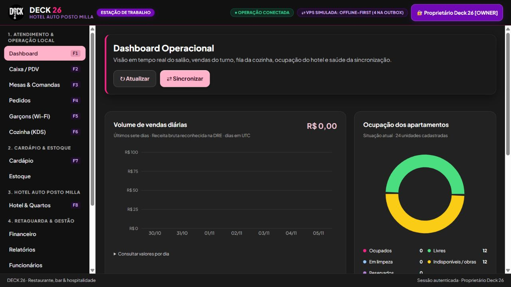

# DECK 26 · Gestão & Hospitalidade

Restaurante, bar, delivery e Hotel Auto Posto Milla em uma operação local integrada.

[](https://github.com/Duailibe32/deck26-system/actions/workflows/ci.yml)



## Estado do projeto

Etapa 7A revisada antes da 7B. A interface Windows usa a API operacional local. A prévia web é uma demonstração separada, com dados fictícios guardados somente no navegador. Nenhum serviço foi publicado online por esta revisão.

A revisão corrige falhas de inicialização, autenticação, autorização, pagamentos, custódia de entregadores e atomicidade do PMS. Os testes automatizados não substituem a conferência do histórico financeiro, a homologação fiscal e a validação de impressoras e do instalador Windows.

## Experiência de uso

- Paleta: rosa #F72585, preto #111111, roxo #7209B7 e cinza #1A1A1A; fonte Plus Jakarta Sans e marca fornecida pelo proprietário.
- Botões com hierarquia visual, foco de teclado, estados de interação e áreas de toque maiores.
- Windows Desktop: mesas verdes livres, amarelas ocupadas e vermelhas aguardando pagamento; limpeza azul e indisponibilidade cinza. Textos e símbolos acompanham as cores.
- Dashboard Recharts responsivo: vendas dos últimos sete dias e distribuição atual dos apartamentos. No Windows, vendas são receita bruta reconhecida na DRE, não saldo bancário; os dias seguem UTC. A prévia web identifica seus recebimentos como fictícios.
- Prévia interativa: catálogo com busca, comandas por mesa, pagamento parcial, transferência ao quarto, hospedagem, delivery, financeiro e documentos de exemplo sem validade fiscal.

## Estrutura

| Pasta | Responsabilidade |
|---|---|
| apps/desktop | Interface operacional React/Vite, preparada para Tauri 2 |
| apps/local-server | API Fastify e SQLite da operação |
| apps/cloud-api | Simulador de nuvem SQLite com sincronização autenticada |
| apps/web | Demonstração comercial independente |
| packages/contracts | Contratos Zod e regras compartilhadas |
| packages/ui | Identidade visual, botões e gráficos compartilhados |

PostgreSQL, emissão SEFAZ/prefeitura e sincronização completa entre todos os módulos ainda não estão implementados. Configurar DATABASE_URL não ativa PostgreSQL.

## Começar no Windows

Requer Node.js 22.13 ou superior e npm. Na raiz do repositório:

```powershell
npm ci
Copy-Item .env.example .env
```

Preencha .env antes de iniciar os servidores:

- DECK26_AUTH_SECRET e DECK26_QR_SEED_SECRET: valores aleatórios fortes e distintos.
- DECK26_SYNC_SECRET: segredo compartilhado pelos dois servidores.
- DECK26_BOOTSTRAP_PIN: PIN próprio de 6 a 12 dígitos para criar o proprietário; remova a variável após o primeiro uso.
- DECK26_DEMO_MODE=false: bancos novos começam sem hóspedes, estoque, receitas, saldos fictícios ou usuários de exemplo. Cadastre e confira os dados reais antes da operação.

Uma forma de gerar cada segredo é executar localmente: node -e "console.log(require('crypto').randomBytes(32).toString('hex'))". Não compartilhe os valores nem versione .env.

```powershell
npm run dev:all
```

| Acesso local | Endereço |
|---|---|
| Windows Desktop no navegador | http://localhost:5173 |
| Prévia comercial fictícia | http://localhost:5174 |
| Saúde da API local | http://127.0.0.1:4000/api/health |
| Saúde do simulador cloud | http://127.0.0.1:4100/api/health |

Para conhecer somente o visual: npm run dev:web. Para testar a operação com exemplos, use DECK26_DEMO_MODE=true e **um caminho de banco descartável**, nunca o banco operacional. Os PINs de exemplo são recusados em produção. As APIs carregam o .env da raiz automaticamente pelos scripts npm. Os bancos relativos são resolvidos a partir do diretório de cada aplicativo; prefira caminhos absolutos ao configurar um ambiente real.

## Verificar

```powershell
npm run typecheck
npm test
npm run build
npm audit --audit-level=moderate
```

A validação local de 05/11/2026 executou 140 testes, inicialização real das duas APIs pelo Node, verificação de tipos e compilação das interfaces. A instalação revisada reportou zero vulnerabilidades conhecidas. O selo do GitHub mostra o resultado da validação remota do commit publicado.

O build não gera um instalador Tauri. O empacotamento Windows exige Rust, WebView2 e ferramentas C++; hardware e emissão fiscal precisam de validação própria.

## Aplicativo Windows nativo para teste

A tela de login bloqueia os módulos até autenticação por PIN. O ambiente nativo de teste usa API local e SQLite persistente separado, sem cobranças ou documentos fiscais reais. Consulte [como gerar, abrir e testar](docs/WINDOWS_TEST.md).

Execute npm run build:windows:test no Windows com Rust/MSVC instalados; o script scripts/install-windows-test-shortcut.ps1 cria o atalho que inicia API e janela nativa juntos. O executável não incorpora a API nem substitui a homologação operacional.

## Segurança, financeiro e preparação da 7B

Leia [revisão e evidências](docs/REVISAO_PRE_7B.md), [segurança](docs/SECURITY.md), [invariantes financeiras](docs/FINANCIAL_INVARIANTS.md), [testes](docs/TESTING.md) e [checklist de produção](docs/PREPRODUCTION_CHECKLIST.md).

Antes de aplicar a nova versão a um banco existente, faça backup consistente e ensaie a migração em uma cópia. A revisão não reconstrói movimentos históricos ausentes: concilie saldos de caixa, banco, cartões e carteira de entregadores com extratos e registros reais. Consulte [backup e recuperação](docs/BACKUP_AND_RECOVERY.md).

Não publique a API operacional nem o servidor de desenvolvimento Vite na internet. A 7B deve configurar HTTPS, origem autorizada, cópias de segurança e monitoramento, além de validar o ambiente de hospedagem. O simulador cloud não equivale a uma implantação homologada.
