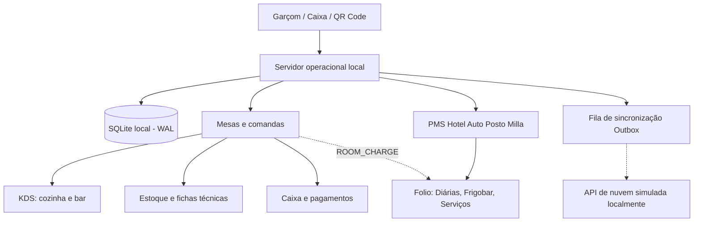

<div align="center">

# DECK 26

### Gestão integrada para bar, restaurante e hotel

**Operação local • Pedidos em tempo real • Controle financeiro • Arquitetura offline-first**

[](https://github.com/Duailibe32/deck26-system/actions/workflows/ci.yml)


**[Visão geral](#-visão-geral) · [Funcionalidades](#-funcionalidades) · [Arquitetura](#-arquitetura) · [Instalação](#-começando-no-windows) · [Roadmap](#-roadmap)**

</div>

---

## ✨ Visão geral

O **DECK 26** é uma plataforma de gestão integrada desenvolvida para a operação comercial do **Deck 26 / Hotel Auto Posto Milla**, reunindo restaurante, bar, atendimento de mesas, cozinha, estoque, caixa, delivery próprio, gestão financeira integrada (tesouraria, fluxo de caixa e DRE gerencial) e o sistema hoteleiro completo (**PMS - Property Management System**).

A arquitetura é **offline-first**: a operação principal utiliza um servidor e um banco de dados locais, permitindo continuar trabalhando com latência zero e sem dependência de internet externa. A sincronização com uma instância remota faz parte da arquitetura; atualmente, a nuvem é **simulada localmente**, sem exigência de contratação prévia de VPS.

> [!IMPORTANT]
> **Status atual:** Etapas 1 a 7A concluídas e auditadas, com **119 testes automatizados aprovados** e pipeline de CI no GitHub Actions. Inclui demonstração comercial online mobile-first (7 módulos, dados simulados e fallback sem backend), 24 apartamentos no Hotel Auto Posto Milla (12 operacionais + 12 em construção com trava estrita de venda e cálculo exato de ocupação), cardápio oficial com 93 produtos em 10 categorias e módulo fiscal preparatório multi-estabelecimento (Restaurante CNPJ 12345678000190 NFC-e vs Hotel CNPJ 12345678000271 NFS-e). Documentação técnica em `docs/`.

### 🎯 Cenário operacional planejado

| Terminal | Finalidade |
| --- | --- |
| 🖥️ **Windows / recepção** | Caixa PDV, mesas, comandas, estoque, governança, reservas e PMS hoteleiro |
| 📱 **Até 5 celulares** | Atendimento de garçons pela rede local Wi-Fi |
| 👨‍🍳 **KDS da cozinha** | Acompanhamento de pedidos e estações de preparo (Cozinha Quente/Fria, Chapa, Bar) |
| 📲 **QR Code nas mesas** | Cardápio digital e pedidos vinculados à mesa com assinatura HMAC |
| ☁️ **Nuvem futura** | Sincronização bidirecional e portal remoto após implantação na VPS |

## 🚀 Funcionalidades

| Área | Recursos desenvolvidos | Estado |
| --- | --- | --- |
| **Cardápio oficial (93 itens)** | 93 produtos catalogados em 10 categorias (Pratos executivos, Tapiocas, Cafeteria, etc.), SKUs únicos, estações de preparo, preços por canal e campos fiscais | Implementado; testes automatizados |
| **Estoque Kardex** | Razão contábil, entradas de compra, baixas automáticas, fichas técnicas e estornos auditáveis | Implementado; testes automatizados |
| **Mesas e comandas** | Estado físico vs financeiro, transferência, junção, separação e prevenção de duplicidade | Implementado; testes automatizados |
| **Garçons** | Terminal mobile, lançamento de pedidos, canal dedicado e notificações instantâneas | Implementado; testes automatizados |
| **Cozinha / KDS** | Filas por estação, SLA configurável, SSE em tempo real e cancelamento por estágio | Implementado; testes automatizados |
| **Caixa / PDV** | Pagamentos parciais/mistos, divisão de conta, troco em espécie, sangrias e turno de caixa | Implementado; testes automatizados |
| **QR Code & Demo Online** | Cardápio digital QR Code e Demonstração Comercial Web Mobile-First (7 módulos com dados simulados e zero backend fallback) | Implementado; testes automatizados |
| **Impressão** | Spooler incremental ESC/POS por estação, proteção `UNKNOWN_OUTCOME`, 2ª via e Pré-Conta conferencial | Software implementado; hardware a conectar |
| **Hotel (PMS Milla - 24 Apts)** | 24 apartamentos (12 operacionais + 12 em construção com trava estrita de venda e exclusão do denominador de ocupação), assistente gerencial de edição, reservas sem sobreposição, check-in, folio, `ROOM_CHARGE`, frigobar e métricas ADR/RevPAR | Implementado; 49 testes automatizados |
| **Delivery Próprio** | Central de pedidos, regiões/bairros com taxas fixas, despacho de motoboys, prestação de contas no caixa com transferência de custódia e ciclo completo de status | Implementado; testes automatizados |
| **Gestão Financeira & DRE** | Plano de contas gerencial, centros de custo, tesouraria multi-contas, contas a pagar/receber, compras com NF e Kardex, transferências internas, conciliação e DRE por competência | Implementado; testes automatizados |
| **Relatórios & Exportação CSV** | Demonstrativo contábil, curva ABC, auditoria e exportação CSV blindada contra Formula Injection (`sanitizeCsvCell`) | Implementado; testes automatizados |
| **Preparação Fiscal (Multi-CNPJ)** | Segregação estrutural Restaurante (CNPJ Matriz - NFC-e Mod 65) vs Hotel (CNPJ Filial - NFS-e Municipal), distinção pré-conta / comprovante / documento fiscal e simulação de chave de 44 dígitos com tarja SEM VALIDADE FISCAL | Arquitetura e simulação implementadas; homologação SEFAZ/prefeitura futura |

### 🔄 Como os módulos se conectam



Os consumos do bar e restaurante podem ser transferidos diretamente para o apartamento do hóspede (`ROOM_CHARGE`). A mesa é liberada no restaurante sem duplicar baixas no estoque de insumos e sem inflar o caixa diário.

## 🧱 Arquitetura

O projeto é um **monorepositório npm Workspaces** com quatro aplicações e dois pacotes compartilhados:

```text
deck26-system/
├── apps/
│   ├── desktop/          # React 19 / Tauri 2; PDV, garçom, KDS e PMS Hotel
│   ├── local-server/     # Fastify, SQLite nativo WAL, RBAC, SSE e PMS engine
│   ├── cloud-api/        # Simulador local da API remota da VPS (SQLite / PostgreSQL)
│   └── web/              # Cardápio Digital QR Code e interfaces web públicas
├── packages/
│   ├── contracts/        # Zod, matriz de permissões, regras e migrações SQL
│   └── ui/               # Design system oficial (Rosa/Preto/Roxo) e componentes
├── docs/                 # Documentação técnica detalhada de cada subsistema
├── scripts/              # Orquestrador local de desenvolvimento (dev-all.mjs)
├── .github/workflows/    # Pipeline de Integração Contínua (CI)
└── INICIAR-DECK26-DEV.bat# Inicializador do ambiente local Windows 11
```

## 💻 Começando no Windows

### Pré-requisitos
- Windows 11 (64 bits)
- Node.js **22.5+** com suporte a `node:sqlite` nativo
- npm 10+
- Git

### 1. Obter o projeto e instalar dependências

```powershell
git clone https://github.com/Duailibe32/deck26-system.git
cd deck26-system
npm install
```

### 2. Executar localmente

Execute o inicializador automático:
```powershell
.\INICIAR-DECK26-DEV.bat
```
Ou inicie todos os serviços via npm:
```powershell
npm run dev:all
```

| Serviço | Endereço no navegador local |
| --- | --- |
| Painel principal / PDV / PMS Hotel | `http://localhost:5173` |
| Terminal mobile do garçom | `http://localhost:5173/?terminal=garcom` |
| Cozinha / KDS | `http://localhost:5173/?terminal=cozinha` |
| Cardápio web e delivery | `http://localhost:5174` |
| API operacional local | `http://127.0.0.1:4000/api/health` |
| API da nuvem simulada | `http://127.0.0.1:4100/api/health` |

## 🧪 Testes e integração contínua

Execute na raiz do repositório:

```powershell
npm run typecheck
npm test
npm run build
```

O projeto conta com **71 testes automatizados aprovados** cobrindo contratos, regras de domínio, API do servidor, cenários do KDS, caixa, outbox e o ciclo completo de 20 passos do PMS hoteleiro:

- [Ver workflow de CI](.github/workflows/ci.yml)
- [Acompanhar execuções do GitHub Actions](https://github.com/Duailibe32/deck26-system/actions)

## 🔐 Segurança e limites atuais

- **Autorização:** permissões tipadas por perfil (RBAC) com namespaces `tabs:*`, `cash:*`, `kds:*`, `hotel:*`.
- **Segredos:** variáveis de ambiente privadas fora do versionamento; segredo de autenticação obrigatório em produção.
- **Integridade:** operações financeiras e de estoque com regras transacionais estritas e idempotência.
- **Rede:** servidor local isolado em `127.0.0.1` por padrão; exposição LAN requer configuração consciente.
- **Privacidade:** bancos SQLite locais, backups e certificados digitais são protegidos pelo `.gitignore`.

### Dependências ainda não homologadas

1. **Fiscal:** emissão de NFC-e/NF-e permanece desabilitada até configuração do Certificado A1 real e CSC.
2. **Pagamentos eletrônicos:** registros manuais operam em modo declarado até a homologação com adquirente/TEF/PIX bancário.
3. **Impressoras térmicas:** geração e fila ESC/POS prontas no banco; envio físico USB/Ethernet aguarda hardware real.
4. **VPS:** a API remota continua simulada localmente com persistência independente; PostgreSQL será ativado no deploy de produção.
5. **Instalador Windows:** o aplicativo nativo definitivo Tauri 2 será empacotado após a validação completa dos fluxos.

## 🗺️ Roadmap

- [x] **Etapa 1** — Estrutura do monorepositório e arquitetura inicial
- [x] **Etapa 2** — Persistência local dual SQLite, autenticação inicial, pagamentos parciais e impressão incremental
- [x] **Etapa 3** — Catálogo integrado aos 6 canais, estoque Kardex com reversão, fichas técnicas e QR Code seguro
- [x] **Etapa 4** — Mesas, comandas transacionais, garçons, KDS com SLA/SSE, divisão de contas e caixa
- [x] **Etapa 4.5** — GitHub privado, documentação técnica completa, auditoria e CI
- [x] **Etapa 5** — Gestão hoteleira completa (Hotel Auto Posto Milla): PMS, reservas sem sobreposição, check-in guiado, extrato de folio, integração `ROOM_CHARGE` com restaurante Deck 26, frigobar, governança e métricas ADR/RevPAR
- [x] **Etapa 6** — Delivery próprio, gestão financeira integrada (tesouraria, contas a pagar/receber, compras NF/Kardex, transferências, conciliação), fluxo de caixa, DRE gerencial por competência e relatórios CSV protegidos contra Formula Injection
- [ ] **Etapa 7** — Implantação em VPS, PostgreSQL e instalador Windows definitivo

## 📚 Documentação

| Documento | Conteúdo |
| --- | --- |
| [Arquitetura](docs/ARCHITECTURE.md) | Componentes, fluxos e serviços |
| [Instalação local](docs/LOCAL_SETUP.md) | Configuração no Windows e rede |
| [Banco de dados](docs/DATABASE.md) | SQLite, migrações e plano PostgreSQL |
| [API](docs/API.md) | Endpoints REST, SSE e PMS Hoteleiro |
| [Segurança](docs/SECURITY.md) | Autenticação, RBAC e proteção de dados LGPD |
| [Testes](docs/TESTING.md) | Execução e 71 cenários automatizados |
| [Implantação](docs/DEPLOYMENT_PLAN.md) | Planejamento da VPS e do Windows definitivo |
| [Roadmap](docs/ROADMAP.md) | Etapas e prioridades |
| [Histórico de mudanças](docs/CHANGELOG.md) | Evolução técnica |

---

<div align="center">

### DECK 26

**Tecnologia para conectar atendimento, operação e gestão.**

<sub>Software proprietário • Todos os direitos reservados • Deck 26 / Hotel Auto Posto Milla</sub>

</div>
