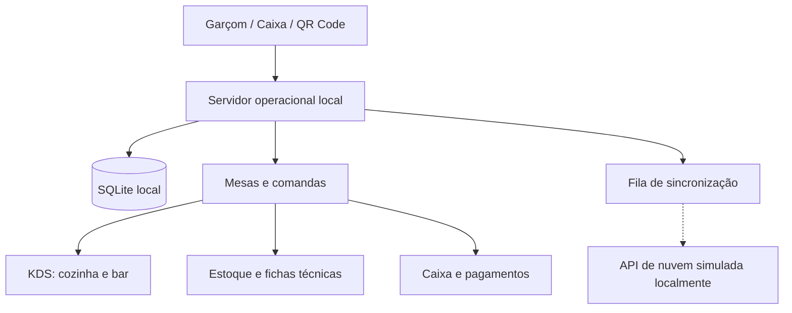

<div align="center">

# DECK 26

### Gestão integrada para bar, restaurante e hotel

**Operação local • Pedidos em tempo real • Controle financeiro • Arquitetura offline-first**

[](https://github.com/Duailibe32/deck26-system/actions/workflows/ci.yml)


**[Visão geral](#-visão-geral) · [Funcionalidades](#-funcionalidades) · [Arquitetura](#-arquitetura) · [Instalação](#-começando-no-windows) · [Roadmap](#-roadmap)**

</div>

---

## ✨ Visão geral

O **DECK 26** é uma plataforma de gestão integrada desenvolvida para a operação do **Deck 26 / Hotel Auto Posto Milla**, reunindo restaurante, bar, atendimento de mesas, cozinha, estoque, caixa e uma base para a futura gestão hoteleira.

A arquitetura é **offline-first**: a operação principal utiliza um servidor e um banco de dados locais, permitindo continuar trabalhando durante indisponibilidades da internet externa. A sincronização com uma instância remota faz parte da arquitetura; atualmente, a nuvem é **simulada localmente**, sem implantação em VPS de produção.

> [!IMPORTANT]
> **Status atual:** etapas 1 a 4.5 implementadas segundo o histórico do projeto, com testes automatizados e CI configurados. Ainda são necessários testes operacionais com dispositivos reais, impressoras e integrações externas antes do uso em produção.

### 🎯 Cenário operacional planejado

| Terminal | Finalidade |
| --- | --- |
| 🖥️ **Windows / recepção** | Caixa, PDV, mesas, comandas, estoque e administração |
| 📱 **Até 5 celulares** | Atendimento de garçons pela rede local |
| 👨‍🍳 **KDS da cozinha** | Acompanhamento de pedidos e estações de preparo |
| 📲 **QR Code nas mesas** | Cardápio e pedidos vinculados à mesa |
| ☁️ **Nuvem futura** | Sincronização e serviços remotos após implantação |

## 🚀 Funcionalidades

| Área | Recursos desenvolvidos | Estado |
| --- | --- | --- |
| **Produtos e cardápio** | Cadastro, categorias, preços por canal, adicionais e histórico de preços | Implementado; testes automatizados |
| **Estoque** | Kardex, entradas, baixas, fichas técnicas e estornos auditáveis | Implementado; testes automatizados |
| **Mesas e comandas** | Abertura, transferência, junção, divisão e fechamento | Implementado; testes automatizados |
| **Garçons** | Terminal mobile, lançamento de pedidos e avisos de preparo | Implementado; testes automatizados |
| **Cozinha / KDS** | Filas por estação, status, SLA e eventos em tempo real via SSE | Implementado; testes automatizados |
| **Caixa / PDV** | Pagamentos parciais, divisão de conta, troco, descontos, sangrias e fechamento de turno | Implementado; testes automatizados |
| **QR Code** | Identificação segura de mesa e validação de preços no servidor | Implementado; testes automatizados |
| **Impressão** | Fila incremental ESC/POS, controle de falhas e segunda via | Software implementado; hardware não homologado |
| **Hotel** | Estrutura inicial de quartos e conta de hospedagem | Parcial; expansão na Etapa 5 |
| **Delivery e painel remoto** | Estrutura de canais e interfaces web | Expansão planejada |
| **Fiscal / pagamentos bancários** | Campos e preparação para integração | Integrações reais pendentes |

### 🔄 Como os módulos se conectam



Os pedidos são associados às comandas, encaminhados às estações de preparo e registrados para atualização de estoque e fechamento financeiro. A lógica de impressão incremental evita recriar automaticamente tickets de pedidos anteriores.

## 🧱 Arquitetura

O projeto é um **monorepositório npm Workspaces** com quatro aplicações e dois pacotes compartilhados.

```text
deck26-system/
├── apps/
│   ├── desktop/          # React / Tauri 2; PDV, garçom e KDS
│   ├── local-server/     # Fastify, SQLite WAL, autenticação e SSE
│   ├── cloud-api/        # Simulador local da API remota
│   └── web/              # Cardápio e interfaces web
├── packages/
│   ├── contracts/        # Zod, regras, tipos e migrações SQL
│   └── ui/               # Design system e componentes
├── docs/                 # Guias técnicos e operacionais
├── scripts/              # Scripts de desenvolvimento
├── .github/workflows/    # Integração contínua
├── .env.example          # Exemplo sem segredos
└── package.json          # Scripts e workspaces
```

### Tecnologias

| Camada | Stack |
| --- | --- |
| Interface | React 19, TypeScript 5.7, Vite 6 |
| Desktop | Tauri 2 e WebView2 |
| API local | Node.js 22+, Fastify 5, SSE |
| Dados locais | SQLite nativo (`node:sqlite`) com WAL |
| API remota simulada | Fastify e SQLite independente |
| Banco futuro de produção | PostgreSQL 16 (planejado) |
| Contratos | Zod, RBAC e valores monetários em centavos inteiros |
| Qualidade | Vitest e GitHub Actions |

**Identidade visual:** rosa `#F72585`, preto `#111111`, roxo `#7209B7`, neutro `#1A1A1A` e fonte **Plus Jakarta Sans**.

## 💻 Começando no Windows

### Pré-requisitos

- Windows 11 (64 bits)
- Node.js **22.5+** com suporte a `node:sqlite` (preferencialmente versão compatível com o CI)
- npm 10+
- Git
- Acesso autorizado ao repositório privado

### 1. Obter o projeto

```powershell
git clone https://github.com/Duailibe32/deck26-system.git
cd deck26-system
```

### 2. Instalar dependências

```powershell
npm ci
```

### 3. Configurar o ambiente (quando necessário)

```powershell
Copy-Item .env.example .env
```

Consulte os comentários de `.env.example` e o guia [`docs/LOCAL_SETUP.md`](docs/LOCAL_SETUP.md). **Nunca envie o arquivo `.env` ao GitHub.**

### 4. Iniciar os serviços

No Windows, execute o arquivo `INICIAR-DECK26-DEV.bat` ou use:

```powershell
npm run dev:all
```

### Endereços em desenvolvimento

| Serviço | Endereço no próprio computador |
| --- | --- |
| Painel principal / PDV | `http://localhost:5173` |
| Terminal do garçom | `http://localhost:5173/?terminal=garcom` |
| Cozinha / KDS | `http://localhost:5173/?terminal=cozinha` |
| Cardápio web | `http://localhost:5174` |
| API local | `http://127.0.0.1:4000/api/health` |
| API de nuvem simulada | `http://127.0.0.1:4100/api/health` |

> [!NOTE]
> `localhost` funciona apenas no próprio dispositivo. Para acesso por celulares, é necessário configurar explicitamente a rede local, o endereço IP, as permissões e a segurança. O servidor local escuta em `127.0.0.1` por padrão; consulte a documentação antes de habilitar acesso LAN.

## 🧪 Testes e integração contínua

Execute na raiz do repositório:

```powershell
npm run typecheck
npm test
npm run build
```

O relatório da Etapa 4.5 registrou **35 testes aprovados** e uma execução bem-sucedida do pipeline GitHub Actions no commit `8f240e1`.

- [Ver workflow de CI](.github/workflows/ci.yml)
- [Acompanhar execuções do GitHub Actions](https://github.com/Duailibe32/deck26-system/actions)
- [Execução de referência informada](https://github.com/Duailibe32/deck26-system/actions/runs/41785656827)

O badge no topo mostra o estado mais recente do workflow; ele não substitui a homologação operacional.

## 🔐 Segurança e limites atuais

- **Autorização:** permissões por perfil (RBAC) validadas no backend.
- **Segredos:** variáveis de ambiente privadas fora do versionamento; segredo de autenticação obrigatório em produção.
- **Integridade:** operações financeiras e de estoque com regras transacionais e idempotência.
- **Rede:** servidor local isolado por padrão; exposição LAN requer configuração consciente.
- **Privacidade:** bancos SQLite, backups e certificados não devem integrar o repositório.

> [!WARNING]
> **Não utilizar os PINs de demonstração em produção.** Antes da implantação, configurar credenciais individuais, persistência segura dos segredos, backups, recuperação de falhas e testes com a rede e os dispositivos definitivos.

### Dependências ainda não homologadas

1. **Fiscal:** emissão de NFC-e/NF-e permanece desabilitada até configuração e validação fiscal apropriadas.
2. **Pagamentos eletrônicos:** registros manuais não comprovam liquidação bancária; integrações PIX/TEF reais estão pendentes.
3. **Impressoras térmicas:** geração e fila ESC/POS existem, mas o envio físico USB/Ethernet depende de hardware e testes.
4. **VPS:** a API remota continua simulada localmente; não há implantação PostgreSQL em produção.
5. **Instalador Windows:** o aplicativo nativo definitivo ainda exige validação de build, instalação e operação no equipamento-alvo.

## 🗺️ Roadmap

- [x] **Etapa 1** — Estrutura do monorepositório e arquitetura inicial
- [x] **Etapa 2** — Persistência local, autenticação inicial, pagamentos e impressão incremental
- [x] **Etapa 3** — Catálogo, estoque, fichas técnicas e QR Code
- [x] **Etapa 4** — Mesas, comandas, garçons, KDS e caixa
- [x] **Etapa 4.5** — GitHub privado, documentação, auditoria e CI
- [ ] **Etapa 5** — Gestão hoteleira: reservas, check-in, check-out, diárias, frigobar e contas de hóspedes
- [ ] **Etapa 6** — Delivery, finanças avançadas e relatórios gerenciais
- [ ] **Etapa 7** — Implantação em VPS, PostgreSQL e instalador Windows definitivo

O roadmap registra marcos de desenvolvimento, **não certificações de prontidão para produção**.

## 📚 Documentação

| Documento | Conteúdo |
| --- | --- |
| [Arquitetura](docs/ARCHITECTURE.md) | Componentes, fluxos e serviços |
| [Instalação local](docs/LOCAL_SETUP.md) | Configuração no Windows e rede |
| [Banco de dados](docs/DATABASE.md) | SQLite, migrações e plano PostgreSQL |
| [API](docs/API.md) | Endpoints REST e SSE |
| [Segurança](docs/SECURITY.md) | Autenticação, RBAC e proteção de dados |
| [Testes](docs/TESTING.md) | Execução e cenários automatizados |
| [Implantação](docs/DEPLOYMENT_PLAN.md) | Planejamento da VPS e do Windows definitivo |
| [Roadmap](docs/ROADMAP.md) | Etapas e prioridades |
| [Histórico de mudanças](docs/CHANGELOG.md) | Evolução técnica |

## 🔄 Atualizando o repositório

Após revisar as alterações e confirmar que não existem dados privados entre os arquivos modificados:

```powershell
npm run typecheck
npm test
npm run build
git status
git add README.md
git commit -m "docs: aprimora README do DECK 26"
git push origin main
```

Para outras atualizações, substitua `README.md` pelos arquivos que realmente deseja versionar. Evite adicionar indiscriminadamente dados locais.

---

<div align="center">

### DECK 26

**Tecnologia para conectar atendimento, operação e gestão.**

<sub>Software proprietário • Todos os direitos reservados • Deck 26 / Hotel Auto Posto Milla</sub>

</div>
