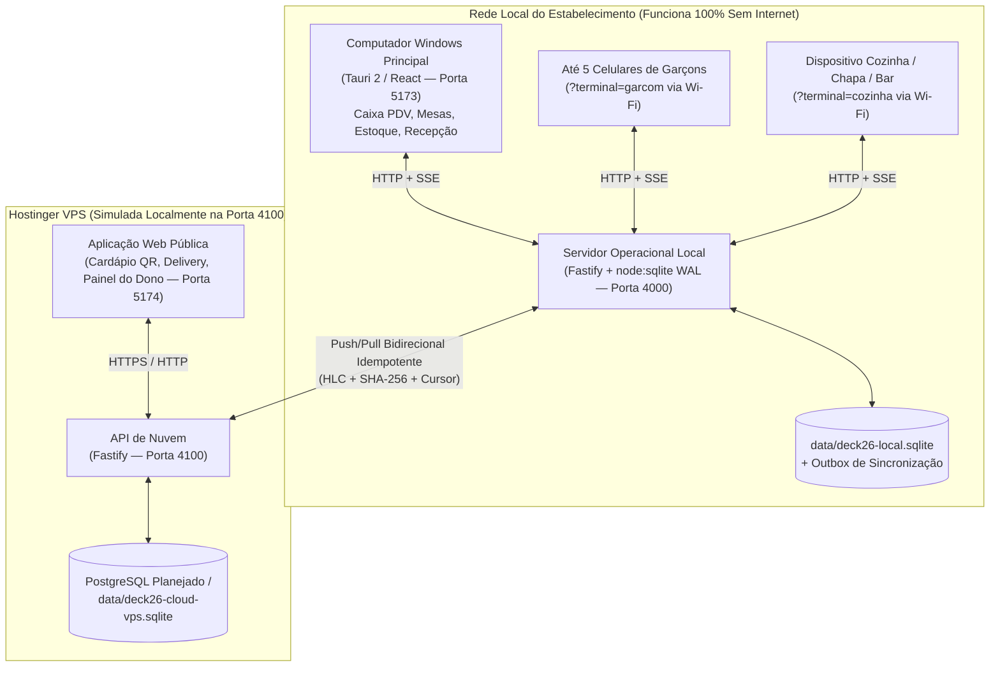

> Estado revisado em 05/11/2026: interfaces React, APIs Fastify e persistência SQLite. Cloud é simulador; PostgreSQL e sincronização integral não implementados. Autenticação protege leituras e mutações; web comercial é demo localStorage independente. Veja REVISAO_PRE_7B.md.

# Arquitetura do Sistema — DECK 26

## 1. Visão Geral

O **DECK 26** utiliza uma arquitetura híbrida **Offline-First Local + Cloud Sync** projetada especificamente para a realidade operacional de bares, restaurantes e hotéis:

- **Operação Crítica Local (`apps/local-server` + `apps/desktop`)**:
  - Todas as operações de abertura de mesa, lançamento de pedidos pelos garçons, fila de produção da cozinha (KDS), impressão térmica por estação, controle de estoque e fechamento de caixa ocorrem na rede local (LAN/Wi-Fi) com banco SQLite transacional (`WAL`).
  - Se a internet externa cair, o restaurante e a recepção do hotel continuam operando sem qualquer interrupção.
- **Camada de Nuvem (`apps/cloud-api` + `apps/web`)**:
  - Recebe os eventos operacionais sincronizados pelo servidor local via Outbox/Inbox idempotente e disponibiliza o Cardápio Digital Público, pedidos externos e o painel de acompanhamento remoto do proprietário.

---

## 2. Separação Estrita de Entidades de Domínio

No DECK 26, cada conceito operacional e financeiro possui sua própria tabela e ciclo de vida independente:

1. **Mesa Física (`DiningTableQr` / `dining_tables_qr`)**: representa o espaço físico no salão (`LIVRE`, `AGUARDANDO_PEDIDO`, `EM_ATENDIMENTO`, `AGUARDANDO_PAGAMENTO`, `LIMPEZA`, `INDISPONIVEL`) e seu token criptográfico de QR Code.
2. **Comanda / Conta Financeira (`Tab` / `tabs`)**: agrupa todos os pedidos, descontos, taxa de serviço, divisão de conta e pagamentos de uma mesa, balcão ou apartamento de hotel (`OPEN`, `BILL_REQUESTED`, `PARTIALLY_PAID`, `CLOSED`, `CANCELLED`).
3. **Pedido Incremental (`Order` & `OrderItem` / `orders` & `order_items`)**: representa cada disparo individual de produção para a cozinha/bar (`PENDING_APPROVAL`, `RECEIVED`, `IN_PREPARATION`, `READY`, `DELIVERED`, `CANCELLED`), congelando o preço histórico no momento da venda.
4. **Pagamento (`Payment` / `payments`)**: registro financeiro vinculado à comanda e ao turno de caixa aberto, suportando pagamentos parciais, mistos, cálculo de troco em espécie e estorno auditado (`CONFIRMED`, `REFUNDED`).
5. **Trabalho de Impressão (`PrintJob` / `print_jobs`)**: fila persistente de tickets ESC/POS roteados por impressora de destino (`PRINTER_KITCHEN_HOT`, `PRINTER_KITCHEN_COLD`, `PRINTER_GRIDDLE`, `PRINTER_BAR`, `PRINTER_CASHIER`).
6. **Movimentação de Estoque (`StockMovement` / `stock_movements`)**: livro-razão (Kardex) imutável de todas as deduções por venda, entradas de compra, perdas e reversões.

---

## 3. Serviços e Portas

| Serviço | Pacote Workspace | Porta Padrão | Finalidade |
| :--- | :--- | :--- | :--- |
| Servidor Operacional Local | `@deck26/local-server` | `4000` | API transacional do salão, garçons, KDS, caixa, estoque e SSE |
| API de Nuvem (Simulador VPS) | `@deck26/cloud-api` | `4100` | Recepção de sincronização (`push`/`pull`) e API pública |
| Aplicativo Desktop / Terminais | `@deck26/desktop` | `5173` | Interface do Caixa Windows, Terminal do Garçom e KDS |
| Site Web / Cardápio QR | `@deck26/web` | `5174` | Cardápio Digital QR Code, Delivery e Painel do Proprietário |

---

## 4. Arquitetura do Módulo Hoteleiro PMS (Hotel Auto Posto Milla)

A Etapa 5 introduziu a gestão completa de PMS hoteleiro com integração nativa às operações de bar e restaurante do Deck 26:

### 4.1 Separação Estrita dos Três Eixos de Status do Quarto
Diferente de sistemas legados que misturam disponibilidade com limpeza, o DECK 26 gerencia 3 máquinas de estado independentes para cada apartamento:
1. **Ocupação (`occupancyStatus`)**: `LIVRE` | `RESERVADO` | `OCUPADO` | `BLOQUEADO`.
2. **Governança (`housekeepingStatus`)**: `LIMPO` | `SUJO` | `EM_LIMPEZA` | `INSPECAO_PENDENTE`.
3. **Manutenção (`maintenanceStatus`)**: `DISPONIVEL` | `EM_MANUTENCAO` | `INTERDITADO`.

Essa separação impede que um quarto marcado como `SUJO` seja erroneamente liberado para venda, ou que um quarto `EM_MANUTENCAO` seja reservado por engano.

### 4.2 Modelo de Conta do Hóspede (Hotel Folio Ledger)
- Toda estadia ativa (`HotelStay`) cria uma comanda correspondente do tipo `HOTEL_FOLIO` (`APTO-XXX`).
- Todos os débitos e créditos são registrados em `hotel_folio_entries` como um razão contábil estrito em centavos inteiros (`amountCents`).
- Débitos (> 0): diárias de hospedagem (`ROOM_RATE`), pedidos transferidos do restaurante (`RESTAURANT_ORDER`), pedidos de bar (`BAR_ORDER`), consumos de frigobar (`MINIBAR`), serviços adicionais (`SERVICE`).
- Créditos (<= 0): pagamentos efetuados (`PAYMENT`), adiantamentos/sinal de reserva (`ADVANCE_PAYMENT`), descontos autorizados (`DISCOUNT`), estornos (`REFUND`).
- **Saldo Devedor Calculado**: `balanceCents = debitsCents - creditsCents`.

### 4.3 Integração Transacional Restaurante -> Hotel (`ROOM_CHARGE`)
- Hóspedes podem consumir no salão do Deck 26 (mesas ou balcão) e solicitar a transferência da despesa para o quarto.
- O endpoint `/api/hotel/transfer-tab-to-folio` valida se o quarto está `OCUPADO` e possui estadia ativa (`ACTIVE`).
- A comanda da mesa é encerrada com pagamento no método `ROOM_CHARGE`.
- A despesa é lançada no Folio do hóspede (`entryType = 'RESTAURANT_ORDER'`).
- **Garantias de Integridade**:
  1. O estoque de insumos **não** sofre dupla baixa (a baixa já ocorreu na confirmação do pedido no restaurante).
  2. Os cupons de produção **não** são reenviados para as impressoras da cozinha/bar.
  3. O caixa diário do restaurante **não** é inflado com numerário inexistente (a receita será recebida no check-out do hotel).

### 4.4 Proteção de Sobreposição de Reservas
- A verificação de disponibilidade considera entrada inclusiva e saída exclusiva: `[inA, outA)` e `[inB, outB)`.
- Duas reservas ou estadias colidem se e somente se: `inA < outB && outA > inB`.
- Permite que um hóspede faça check-in no mesmo dia em que outro hóspede faz check-out (`checkInB == checkOutA`).

### 4.5 Regra de Ouro do Check-Out
- O encerramento da estadia exige saldo devedor quitado (`balanceCents == 0`).
- Se houver pendência financeira, o check-out é bloqueado (`HTTP 400`), exigindo quitação prévia via PIX, Dinheiro ou Cartões, ou autorização expressa documentada no log de auditoria (`allowOverrideWithAudit = true`).
- No encerramento:
  - Estadia é marcada como `CHECKED_OUT`.
  - Quarto passa para ocupação `LIVRE`.
  - Quarto passa para governança `SUJO` (obrigando passagem pela equipe de limpeza).

---

## 5. Arquitetura de Delivery Próprio, Gestão Financeira e DRE (Etapa 6)

A Etapa 6 expandiu o DECK 26 com módulos essenciais de delivery próprio e inteligência contábil-financeira:

### 5.1 Motor de Delivery Próprio & Despacho
- **Zonas de Entrega (`delivery_zones`)**: Taxas fixas em centavos inteiros (`feeCents`) e tempo estimado por bairro, eliminando APIs externas pagas de mapas.
- **Ciclo Transacional do Pedido (`delivery_orders`)**: `NOVO` -> `CONFIRMADO` -> `EM_PREPARO` -> `PRONTO` -> `SAIU_PARA_ENTREGA` -> `ENTREGUE` (ou `CANCELADO`).
- **Recálculo Seguro**: O servidor recalcula subtotal de itens, taxa de entrega por bairro e total (`totalCents`), sem confiar em valores submetidos pelo cliente.
- **Despacho e Custódia (`delivery_settlements`)**: Entregadores vinculados a pedidos recebem dinheiro em espécie na entrega. O fechamento de turno do motoboy realiza a transferência auditada de custódia para o Caixa Geral, pagando as taxas de entrega devidas e emitindo o termo de liquidação.

### 5.2 Gestão Financeira Integrada & Tesouraria Multi-Contas
- **Plano de Contas Gerencial (`financial_categories`)**: Categorias estruturadas por natureza contábil (`REVENUE`, `DEDUCTION`, `COST_DIRECT`, `EXPENSE_OP`, `FINANCIAL_RESULT`).
- **Centros de Custo (`cost_centers`)**: `REST` (Restaurante), `BAR` (Bar e Conveniência), `DELIV` (Delivery Próprio), `HOTEL` (Hotel Auto Posto Milla), `ADMIN` (Administração Geral).
- **Contas Financeiras (`financial_accounts`)**: Caixas físicos (`CASH_DRAWER`, `SAFE_DEPOSIT`), contas bancárias (`BANK_ACCOUNT`), carteiras digitais/chaves PIX (`PIX_KEY`) e custódia temporária (`COURIER_WALLET`).
- **Transferências Internas (`financial_transfers`)**: Sangrias de segurança do PDV para o cofre ou depósitos bancários com duplo lançamento débito/crédito.
- **Conciliação Manual (`account_reconciliations`)**: Confronto do saldo contábil com o extrato real ou conferência física de numerário.

### 5.3 Invariantes Contábeis Rigorosas no DRE Gerencial
O Demonstrativo do Resultado do Exercício por Competência respeita três invariantes contábeis absolutas:
1. **Sem Duplicidade de Receita e Sem Redução de Diárias por `ROOM_CHARGE`**: O consumo de restaurante/bar faturado para o quarto do hotel é reconhecido por competência no restaurante/bar no encerramento da comanda. No folio hoteleiro, lançamentos originados de comandas (`source_reference_type = 'TAB'`) e quitações financeiras são segregados da receita bruta de hospedagem, preservando integralmente o valor real das diárias (`ROOM_RATE`) sem inflar nem duplicar o faturamento.
2. **Ativo Circulante vs Despesa (Estoque & Kardex)**: Notas fiscais de compra (`purchase_invoices`) creditam contas a pagar e debitam o estoque Kardex como ativo circulante; o CMV (Custo das Mercadorias Vendidas) ocorre estritamente na venda ou consumo por ficha técnica.
3. **Movimentações de Custódia**: Prestação de contas de motoboys, sangrias e transferências de saldo são movimentações de custódia e não afetam receitas nem despesas no DRE.

---

## 6. Auditoria Geral, Segurança e Homologação Operacional (Etapa 6.5)

A Etapa 6.5 consolidou uma auditoria técnica profunda e testes de regressão automatizados em todo o sistema:
- **Correção de Flakiness por Data:** Eliminação de datas fixas hardcoded em asserções de testes hoteleiros e DRE, tornando a suíte de testes 100% resiliente a viradas de data e fuso horário.
- **Rigor Matemático em Centavos:** Garantia de aditividade exata e saldo restante R$ 0,00 em contas fracionadas em múltiplos pagamentos (PIX, Dinheiro, Cartões).
- **Proteção RBAC em Rotas Financeiras:** Aplicação de `authorizePermission(..., 'finance:view_dre')` e `'delivery:settle'` nos endpoints gerenciais, impedindo acesso indevido por operadores de salão ou cozinha.
- **Modo Estrito de Autenticação Automático:** `requireStrictAuth` ativado automaticamente quando `NODE_ENV === 'production'`, exigindo segredo forte HMAC (`DECK26_AUTH_SECRET`).
- **Gestão Segura de Contas Bancárias:** Capacidade de renomear e desativar contas demonstrativas sem apagar o histórico de transações ou corromper a integridade referencial.
- **103 Testes Automatizados Aprovados:** Suíte completa em Vitest cobrindo contratos, PMS hoteleiro, PDV/KDS, finanças, delivery e invariantes contábeis.

### 5.4 Exportação CSV Blindada contra Formula Injection
Todos os endpoints de exportação utilizam `sanitizeCsvCell()`:
- Qualquer valor que inicie com `=`, `+`, `-`, `@`, `\t` ou `\r` é neutralizado com prefixo de apóstrofo (`'`) e envolvido em aspas duplas escapadas (`""`).
- Garante total segurança para abertura dos relatórios no Excel, LibreOffice Calc e Google Planilhas.
