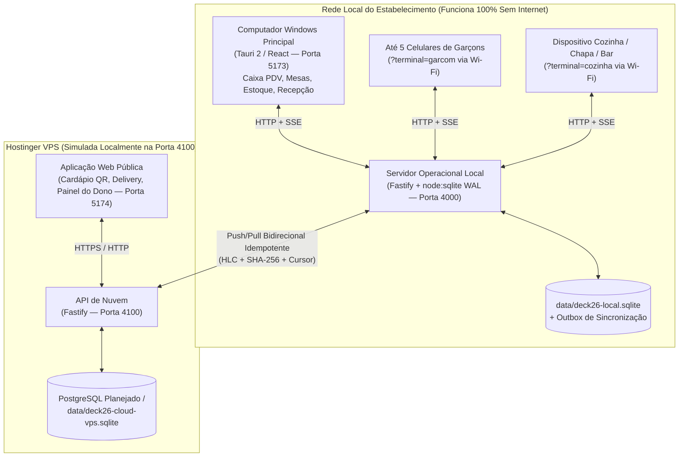

# Arquitetura do Sistema — DECK 26

## 1. Visão Geral

O **DECK 26** utiliza uma arquitetura híbrida **Offline-First Local + Cloud Sync** projetada especificamente para a realidade operacional de bares, restaurantes e hotéis:

- **Operação Crítica Local (`apps/local-server` + `apps/desktop`)**:
  - Todas as operações de abertura de mesa, lançamento de pedidos pelos garçons, fila de produção da cozinha (KDS), impressão térmica por estação, controle de estoque e fechamento de caixa ocorrem na rede local (LAN/Wi-Fi) com banco SQLite transacional (`WAL`).
  - Se a internet externa cair, o restaurante e a recepção do hotel continuam operando sem qualquer interrupção.
- **Camada de Nuvem (`apps/cloud-api` + `apps/web`)**:
  - Recebe os eventos operacionais sincronizados pelo servidor local via Outbox/Inbox idempotente e disponibiliza o Cardápio Digital Público, pedidos externos e o painel de acompanhamento remoto do proprietário.

---

## 2. Separação Estrita de Entidades de Domínio

No DECK 26, cada conceito operacional e financeiro possui sua própria tabela e ciclo de vida independente:

1. **Mesa Física (`DiningTableQr` / `dining_tables_qr`)**: representa o espaço físico no salão (`LIVRE`, `AGUARDANDO_PEDIDO`, `EM_ATENDIMENTO`, `AGUARDANDO_PAGAMENTO`, `LIMPEZA`, `INDISPONIVEL`) e seu token criptográfico de QR Code.
2. **Comanda / Conta Financeira (`Tab` / `tabs`)**: agrupa todos os pedidos, descontos, taxa de serviço, divisão de conta e pagamentos de uma mesa, balcão ou apartamento de hotel (`OPEN`, `BILL_REQUESTED`, `PARTIALLY_PAID`, `CLOSED`, `CANCELLED`).
3. **Pedido Incremental (`Order` & `OrderItem` / `orders` & `order_items`)**: representa cada disparo individual de produção para a cozinha/bar (`PENDING_APPROVAL`, `RECEIVED`, `IN_PREPARATION`, `READY`, `DELIVERED`, `CANCELLED`), congelando o preço histórico no momento da venda.
4. **Pagamento (`Payment` / `payments`)**: registro financeiro vinculado à comanda e ao turno de caixa aberto, suportando pagamentos parciais, mistos, cálculo de troco em espécie e estorno auditado (`CONFIRMED`, `REFUNDED`).
5. **Trabalho de Impressão (`PrintJob` / `print_jobs`)**: fila persistente de tickets ESC/POS roteados por impressora de destino (`PRINTER_KITCHEN_HOT`, `PRINTER_KITCHEN_COLD`, `PRINTER_GRIDDLE`, `PRINTER_BAR`, `PRINTER_CASHIER`).
6. **Movimentação de Estoque (`StockMovement` / `stock_movements`)**: livro-razão (Kardex) imutável de todas as deduções por venda, entradas de compra, perdas e reversões.

---

## 3. Serviços e Portas

| Serviço | Pacote Workspace | Porta Padrão | Finalidade |
| :--- | :--- | :--- | :--- |
| Servidor Operacional Local | `@deck26/local-server` | `4000` | API transacional do salão, garçons, KDS, caixa, estoque e SSE |
| API de Nuvem (Simulador VPS) | `@deck26/cloud-api` | `4100` | Recepção de sincronização (`push`/`pull`) e API pública |
| Aplicativo Desktop / Terminais | `@deck26/desktop` | `5173` | Interface do Caixa Windows, Terminal do Garçom e KDS |
| Site Web / Cardápio QR | `@deck26/web` | `5174` | Cardápio Digital QR Code, Delivery e Painel do Proprietário |
