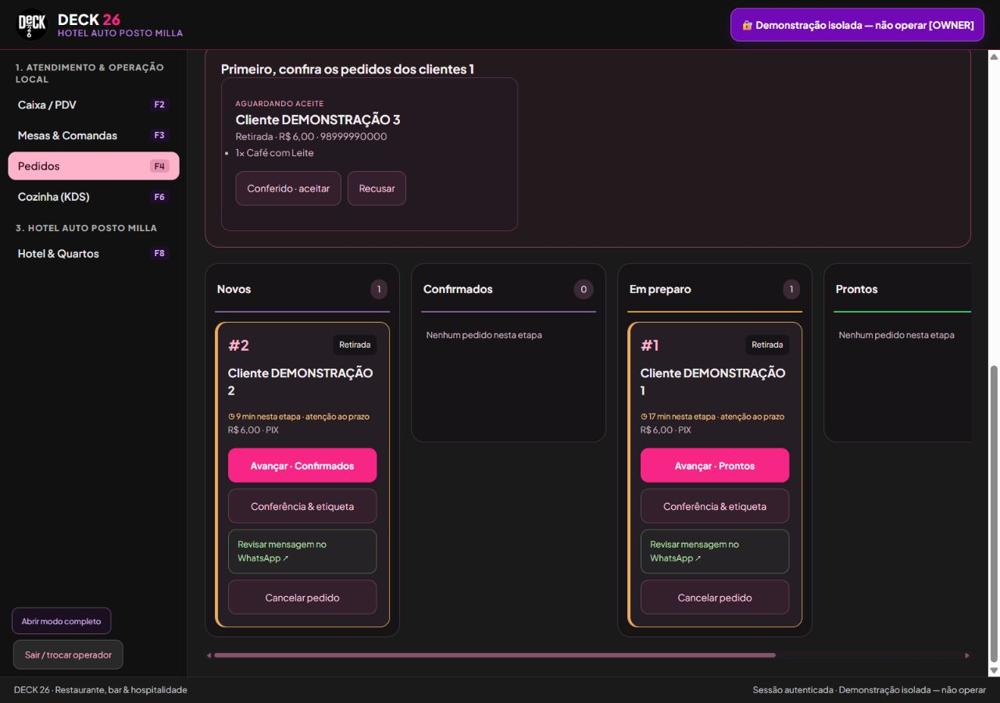
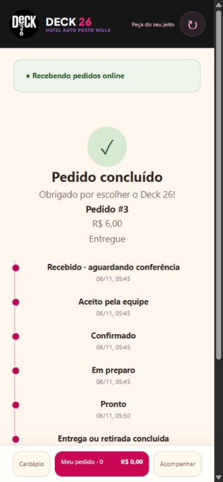

# Delivery — melhorias de atendimento e expedição

Entrega de 06/11/2026. A implementação é própria do DECK 26. O delivery-free foi uma referência de funcionalidades; seu código não foi copiado.

## Onde acessar

**Pedidos → Expedição visual.** Gerência: abrir **Horários, pausas e sugestões do carrinho**. Cliente: link local `/?delivery=1`, exibido em Administração. O PC e o servidor precisam permanecer ligados.

| Melhoria | Comportamento |
| --- | --- |
| Painel em colunas | Novos, confirmados, em preparo, prontos e em rota, com ações por etapa. Encerrados aparecem mediante filtro. Busca por número, nome ou telefone. |
| Prazo por etapa | Contador desde a última atualização; destaque âmbar quando supera a meta configurada. Padrão: 30 minutos. O relógio de cada estação precisa estar correto. |
| Agenda | Horários por dia, inclusive atravessando meia-noite; datas sem atendimento; encerramento manual e pausas de 15/30/60 minutos. |
| Bloqueio no servidor | Novas solicitações e cotações são recusadas enquanto fechado, sem lançar estoque, pedido ou conta. O catálogo continua consultável. |
| Continuidade da fila | Pedidos enviados antes da pausa podem ser conferidos. Reenvio idêntico recupera o pedido anterior; não cria outro. |
| Sugestões opcionais | Até oito produtos configuráveis; até quatro exibidos no carrinho. O cliente escolhe e passa pela personalização normal; nada é adicionado automaticamente. |
| CEP assistido | Consulta opcional ao ViaCEP, com timeout, cache e limite de requisições. Somente os oito dígitos são enviados. Endereço editável e taxa escolhida separadamente. |
| Acompanhamento | Linha do tempo baseada no registro da solicitação e em mudanças reais auditadas. Identificador secreto do pedido, sem histórico público por telefone. Recuperação na mesma sessão do navegador. |
| Expedição | Etiqueta de 80 mm com pedido, cliente, itens, observações, endereço, conferente e volumes; prévia, texto copiável e impressão/PDF pelo navegador. Continua uma simulação, sem equipamento físico. |
| WhatsApp | Atalho abre mensagem para revisão pelo operador; não há envio automático nem confirmação de entrega da mensagem. |
| Recebimento | Conclusão exige uma tela de conferência explícita antes da baixa financeira. Avançar o preparo não registra pagamento. |

## Instalações existentes

A agenda começa desativada e o recebimento mantém o comportamento anterior. Não são inventados horários comerciais ou produtos sugeridos para a operação real. Configure-os com o responsável. Retomar agenda remove pausa/fechamento manual, mas respeita horários e datas fechadas.

As opções são guardadas no JSON de configurações existente, com valores padrão compatíveis; não foi necessário renumerar mesas/quartos ou recriar bancos. PINs, saldos e cadastros operacionais são preservados. Somente a gerência com permissão de funcionários pode alterar a disponibilidade; as rotas de expedição exigem permissão de delivery.

## Validação

- **227 testes automatizados aprovados**, incluindo os 212 anteriores e 15 novos.
- Tipos TypeScript, inicialização das APIs e integridade referencial conferidos.
- Compilação Windows da interface e do executável.
- Novos testes: agenda, virada do dia, pausa, validação de configuração, envio direto bloqueado, reenvio, aceite anterior à pausa, permissões, preservação de configurações, sugestões sem consumo, timeline, etiqueta escapada, CEP inválido/cache/limite/indisponibilidade.
- Conferência visual em banco isolado: painel, aviso de atraso, etiqueta, pausa e retomada, sugestões, consulta real ao CEP público 01001000, envio de retirada fictícia, aceite, preparo, conclusão com recebimento e recuperação do acompanhamento após recarregar.

As capturas usam dados fictícios e não representam vendas reais. Testes de impressora e celular físicos continuam necessários. Consulta de CEP e WhatsApp dependem de internet; o preenchimento manual e os registros no PC permanecem locais. Não há emissão fiscal real ou cobrança bancária automática.

Siga o [checklist específico](CHECKLIST_DELIVERY.md) ou abra a [versão interativa](CHECKLIST_DELIVERY.html).

## Capturas da demonstração isolada

