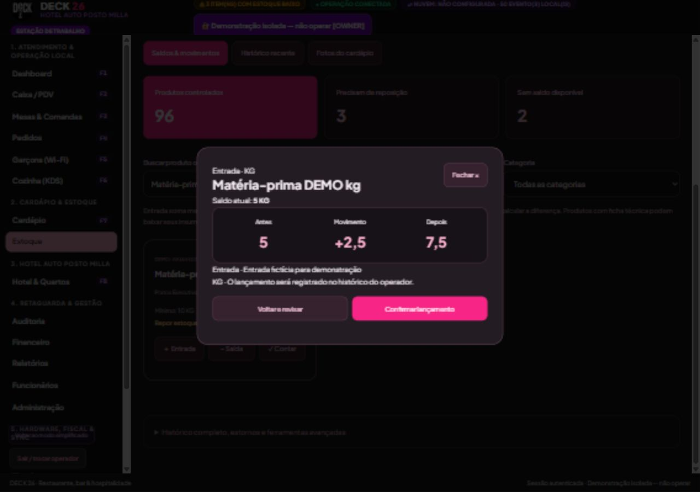
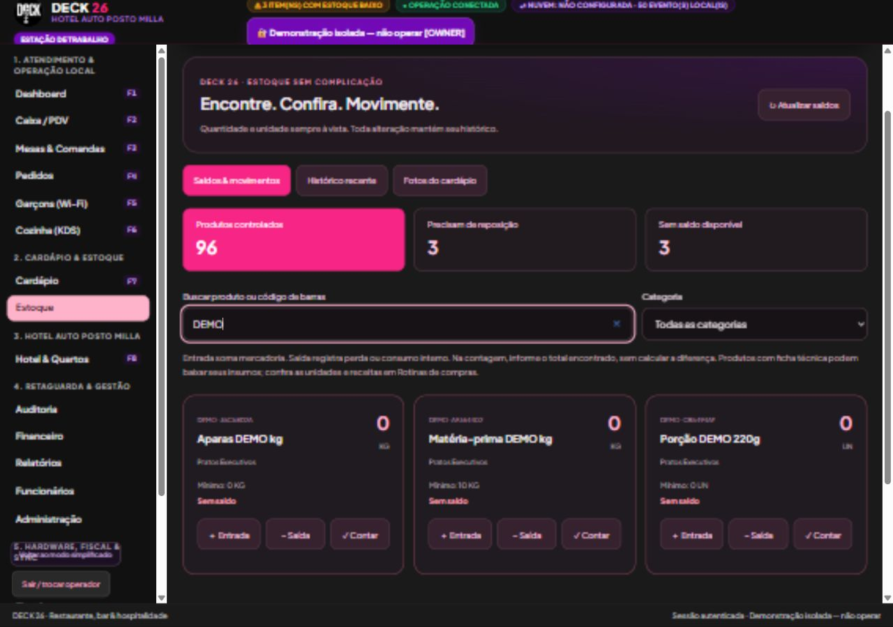
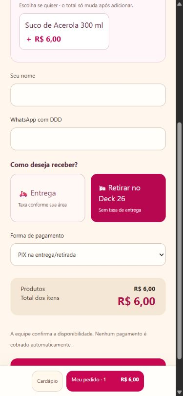

# DECK 26 — Estoque simplificado, fotos e atendimento

Entrega de 06/11/2026. Implementação própria sobre o sistema atual, aproveitando as referências somente como ideias de experiência de uso.

## Onde encontrar

| Recurso | Caminho |
| --- | --- |
| Buscar saldo, entrada, saída e contagem | Estoque → Saldos & movimentos |
| Filtrar zerados ou abaixo do mínimo | Cartões de indicadores no topo do Estoque |
| Consultar lançamentos | Estoque → Histórico recente |
| Fotos dos produtos | Estoque → Fotos do cardápio, com permissão de catálogo |
| Receitas, compras e produção | Estoque → Rotinas de compras, margens e produção |
| Estornos e ferramentas anteriores | Estoque → Histórico completo, estornos e ferramentas avançadas |
| Meta de solicitação sem aceite | Pedidos → Expedição visual → Horários, pausas e sugestões |
| Escolha visual de modalidade | Cardápio do cliente → Meu pedido → Entrega / Retirar no Deck 26 |

## Estoque mais fácil

Busca por nome, SKU ou código de barras; filtro de categoria; itens sem saldo e para reposição; unidade real do produto (UN, KG etc.); ações de entrada, saída e contagem diretamente no cartão. São exibidos somente produtos ativos com controle de estoque.

Na contagem, informe o total encontrado fisicamente: o servidor calcula a diferença. Zero é aceito como contagem válida. A tela apresenta antes, diferença e depois antes de confirmar. Quantidades fracionadas têm até três casas decimais.

A referência de saldo fica congelada desde a abertura da conferência. Se outro atendimento alterar a quantidade, o servidor recusa o lançamento e exige nova conferência. Reenvios preservam a identificação e o conteúdo original; o mesmo envio não gera outra entrada. Contagem sem diferença registra a conferência sem fabricar uma baixa ou entrada.

Entrada avulsa movimenta o estoque e pode atualizar o custo informado, mas não gera automaticamente conta a pagar. Para uma compra com fornecedor e faturamento, use o módulo financeiro. A saída distingue perda de consumo interno. Para refeições da equipe com centro de custo do hotel, continue usando a rotina específica de refeições internas. Produtos com ficha técnica exigem atenção aos insumos e às unidades cadastradas.

## Fotos locais no cardápio

O responsável escolhe o produto e uma foto JPG, PNG ou WebP no próprio computador. O navegador prepara uma cópia JPEG reduzida; o servidor valida tipo, tamanho e dimensões. SVG, endereço externo e arquivo excessivo são recusados. Fotos reais dos pratos precisam ser fornecidas pelo estabelecimento; nenhuma foto de comida foi inventada ou importada para sua operação.

A imagem fica no SQLite, incluída no backup consistente do sistema, e é servida por uma URL local com identificador de conteúdo. O catálogo contém somente a URL, sem transportar todas as imagens dentro de cada atualização. A migração 0012 adiciona a tabela de fotos e preserva os dados existentes. Acesso de edição exige permissão de catálogo; alterações são auditadas. Sem foto, o cardápio mantém o ícone da categoria.

## Atendimento mais claro

- Entrega e retirada viraram botões amplos, com taxa ou ausência de taxa explícita.
- Solicitações sem aceite apresentam o tempo calculado no servidor e ficam destacadas ao alcançar a meta (padrão de três minutos, configurável).
- Há aviso sonoro opcional, ativado pelo operador na sessão, uma vez por solicitação atrasada. O aviso visual funciona com o som desativado.
- Preparo, despacho e confirmação de recebimento mantêm os controles anteriores.

## Verificações realizadas

**241 testes automatizados aprovados**, incluindo os 227 anteriores e 14 novos. Também foram executados checagem de tipos, smoke de inicialização das APIs/integridade referencial e compilação Windows.

Cobertura adicional: entrada auditada, reenvio sem duplicação, recusa de conteúdo alterado, contagem zero/sem diferença, saldo concorrente, saída insuficiente, três casas decimais, atualização de custo, permissões por cargo, foto válida/arquivo inválido, foto persistente após reabrir o banco, migração única, cabeçalhos de imagem e atraso exato na meta.

Um teste antigo de DRE tinha saída de hospedagem fixada em uma data já vencida. A fixture foi corrigida para saída futura relativa ao momento do teste; a validação de datas da operação não foi enfraquecida.

Conferência visual em base isolada: entrada de 2,5 kg alterando saldo de 5 para 7,5 kg; contagem física zero; seleção, prévia, gravação e exibição de foto; troca de entrega/retirada; aviso de solicitação aguardando aceite; ativação/desativação do controle sonoro. A imagem de teste foi a marca existente, somente no banco fictício. Volume/saída física de áudio, celular e impressoras reais devem ser conferidos no equipamento do estabelecimento.

## Limites preservados

Esta entrega não implementa cupons, fidelidade, área autenticada de histórico do cliente ou GPS. São ideias para etapas próprias; o pacote atual prioriza as três melhorias de cardápio/atendimento e a simplificação do estoque. Emissão fiscal real, cobrança bancária e impressão física continuam com as pendências já documentadas. Os testes não registram operações no banco real.

Consulte [CHECKLIST_ESTOQUE_CARDAPIO.md](CHECKLIST_ESTOQUE_CARDAPIO.md) e a [versão interativa](CHECKLIST_ESTOQUE_CARDAPIO.html).

## Capturas da demonstração

