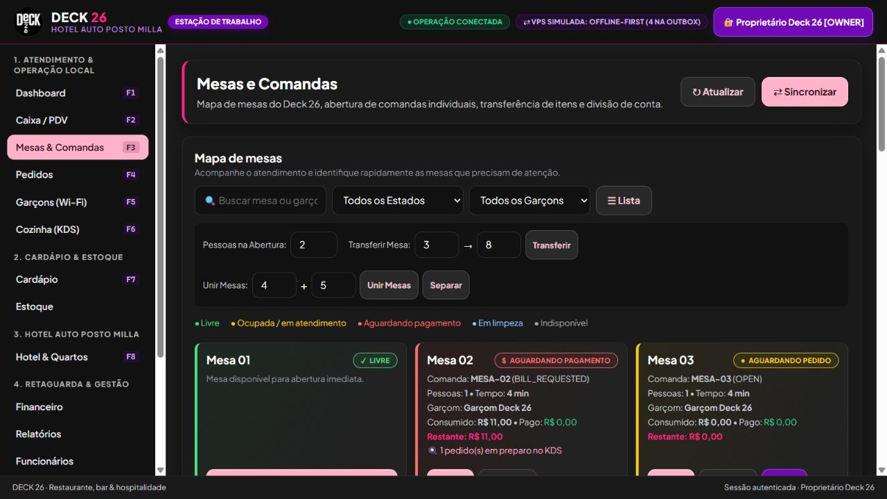
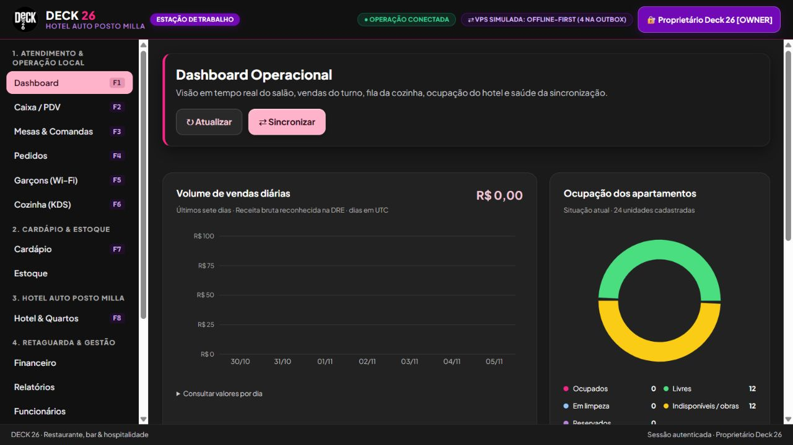

# Revisão independente antes da Etapa 7B

Data: 05/11/2026. Base auditada: 96fbd23f12d322fcdfbe7ed3d3c236890ab7d569 (7A), posterior à 6.5 60ab27e4058b358ac4864fcf05764cf31564f962. Alterações desenvolvidas e verificadas em cópia isolada. Os bancos operacionais e o projeto legado não foram usados nos testes.

## Alegações e evidências

| Alegação anterior | Resultado independente e correção |
|---|---|
| 119 testes, tipos e build aprovados significavam aplicação funcional | As APIs falhavam ao iniciar e a web ficava preta por um ciclo fiscal/index. IsoDateTimeSchema foi isolado em common.ts. O teste de runtime agora inicia ambas as APIs fora do Vitest. |
| Autorização por perfil protegia os dados | Leituras de estado/financeiro e sync permitiam acesso indevido. Hooks de autenticação, permissões de leitura e filtros de dados foram adicionados. |
| Pagamentos alimentavam o financeiro | Restaurante e hotel não alimentavam a tesouraria corretamente. Novos recebimentos geram movimentos vinculados; estornos revertem o movimento. |
| Delivery e acerto não duplicavam entradas | Entrega e acerto podiam reconhecer o dinheiro duas vezes. A carteira do entregador é custódia; o acerto faz transferência e registra a taxa separadamente. Repetição é recusada sem efeito. |
| Checkout era seguro em todas as etapas | Operações compostas podiam persistir parcialmente; override não verificava gerente e razão. Transações/savepoints e validação foram adicionados; falha intermediária é revertida. |
| DRE representava centros de custo e caixa histórico | Rateio fixo 70/30 e filtros incompletos alteravam resultados. A apuração usa origem/preparo dos itens e custos efetivos; o fluxo histórico usa datas dos movimentos e capital inicial. |
| Nuvem e banco externos estavam prontos | A nuvem permanece simulador SQLite. DATABASE_URL é recusada explicitamente porque não existe adaptador PostgreSQL. |
| Fiscal pronto para operar | Os documentos continuam simulados; nenhuma autorização SEFAZ/prefeitura, certificado ou equipamento foi homologado. |

## Mudanças verificáveis

- server.ts local: sessão com validade de oito horas, comparação HMAC segura, usuário ativo consultado no banco, limitação de tentativas de PIN, origens CORS exatas e controle de leitura.
- store.ts: hash scrypt com salt e atualização de credenciais legadas após login válido; bloqueio de PINs demonstrativos em produção; bootstrap de proprietário configurável.
- Modo operacional sem povoamento de dados fictícios. Bases antigas são preservadas; o responsável deve separar exemplos preexistentes de dados reais.
- Pagamentos e folio em centavos inteiros, idempotência coerente, validação de itens pertencentes à comanda e valores positivos; reversão financeira em estornos.
- Recebimentos do hotel em espécie participam da conferência do caixa; sangrias saem do caixa para o cofre sem criar receita.
- PMS: impedimento de check-in em quarto sujo/bloqueado ou com conflito de reserva/estadia; checkout com dívida exige gerente e justificativa auditada.
- Constraints SQLite habilitadas. Migração 0007_hardening reconstrói somente os constraints legados incompatíveis de catálogo/impressão, preservando linhas, índices e triggers e verificando chaves estrangeiras. Triggers impedem UPDATE/DELETE da auditoria pela aplicação.
- Cloud: segredo obrigatório para sync/owner, checksum SHA-256 verificado antes de gravar lote atômico, idempotência e validação de modificadores/preços/canais, limitação de pedidos públicos.
- UI: paleta aprovada, botões consistentes, logo fornecida, mesas com legenda sem depender apenas da cor e gráficos Recharts responsivos com tabela acessível de valores. Windows consulta /api/finance/dashboard/charts com permissão finance:view_dre; prévia usa somente dados fictícios.

## Resultados e limites

140 testes automatizados em oito arquivos e smoke de inicialização real das APIs passaram localmente. Typecheck e build compilam TypeScript e os bundles web/desktop; não validam instalador nativo. npm audit não encontrou vulnerabilidades conhecidas na instalação revisada.

Os testes adicionais estão em apps/local-server/src/hardening.test.ts e apps/web/src/demo.test.ts. Incluem recusa de acesso anônimo, dados pessoais, expiração/revogação de sessão, limite de login, tesouraria, custódia, idempotência, rollback de checkout, DRE, fluxo histórico, cloud e dashboard sem duplicar entrega.

## Prioridades antes de operar

1. Criar backup consistente e ensaiar a atualização em cópia. Conciliar e, com documentação contábil, corrigir saldos e movimentos antigos; não há backfill automático que possa inferir pagamentos ausentes.
2. Substituir credenciais de demonstração por PINs próprios; configurar segredos, destinos e origens exatas. Restringir acesso aos arquivos SQLite e backups no Windows. A imutabilidade em aplicação não protege contra administrador do sistema que altera o arquivo.
3. Validar fluxos reais com caixa, recepção e entregadores, inclusive arredondamentos, divisão, descontos, cartões e taxas. Conta bancária de cartões é uma simplificação; conciliação de adquirente, chargeback e antecipação exigem conferência específica.
4. Configurar e testar restauração, HTTPS/reverse proxy, firewall e monitoramento na 7B. Sync é de um estabelecimento com segredo compartilhado e não implementa todos os conflitos/módulos; não publicar o banco operacional.
5. Homologar impressoras, instalador Windows, NFC-e/NFS-e, certificados, município/UF e contingência com fornecedores e contabilidade. Testes de software não autorizam emissão fiscal.

Os modelos do Stitch foram consultados como referência de organização visual, sem incorporar alegações de homologação, sensores, avaliações, tarifas ou benefícios comerciais fictícios.

As métricas executivas também foram alinhadas à DRE diária: pedidos de delivery ainda pendentes não são reconhecidos como venda. Transferências internas não inflacionam os totais mensais de entradas/saídas; o lucro estimado vem da DRE, não da diferença bruta de movimentações de caixa.

