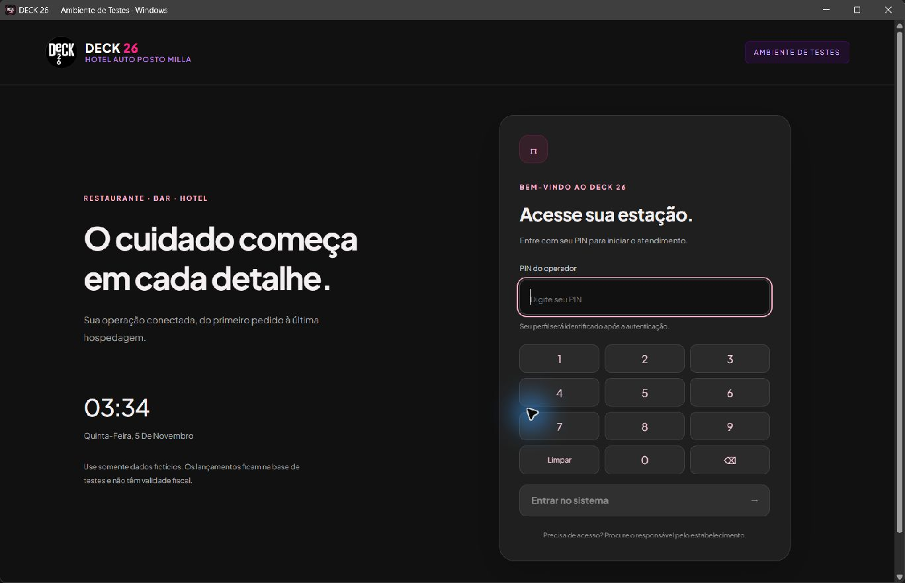

# Teste nativo no Windows

O aplicativo abre em uma janela nativa Tauri/WebView2. A interface usa a API de verdade, com gravação em SQLite persistente, dentro de uma **base exclusiva de testes**. Não é o modo localStorage da prévia comercial.



## Abrir e entrar

Use o atalho **DECK 26 - Teste Windows** da Área de Trabalho. O atalho inicia a API local de teste e abre o executável. A tela de login aparece antes de qualquer módulo operacional.

| Perfil de demonstração | PIN de teste |
|---|---|
| Proprietário | 2626 |
| Gerente | 1010 |
| Caixa | 2020 |
| Garçom | 3030 |
| Cozinha | 4040 |
| Recepção | 5050 |

Essas credenciais pertencem somente ao ambiente fictício. São recusadas em produção. A nova tela começa com PIN vazio, aceita teclado físico/numérico, informa falhas de autenticação e bloqueia envio repetido enquanto aguarda a resposta. Sair/trocar operador desmonta a sessão e limpa os estados da interface. A sessão expirada retorna ao login.

## Roteiro operacional

1. Entre como proprietário e confira o caixa. O seed de demonstração já pode ter um turno aberto.
2. Em Mesas & Comandas, abra uma mesa livre e lance um produto pelo atendimento/PDV.
3. Confira o pedido na cozinha; avance o preparo e a entrega.
4. Solicite a conta: a mesa deve ficar vermelha. Registre recebimento parcial e confira o restante.
5. Registre o restante, encerre a comanda e confira os movimentos financeiros.
6. Teste check-in com hóspede fictício, consumo do restaurante transferido ao quarto, recebimento e checkout.
7. Teste delivery e acerto do entregador; confira a carteira de custódia e os saldos.
8. Feche e reabra pelo atalho: lançamentos permanecem na mesma base de testes. Entre em outro perfil para conhecer as permissões.

Use somente nomes, documentos, telefones e valores fictícios. Selecionar PIX/cartão registra uma operação interna: não inicia cobrança em banco/adquirente. Emissão fiscal e impressoras reais exigem homologação separada.

## Gerar novamente

Instale as ferramentas oficiais Rust/MSVC e o WebView2 indicados na [documentação do Tauri](https://v2.tauri.app/start/prerequisites/). Depois, na raiz:

```powershell
npm ci
npm run build:windows:test
powershell -NoProfile -ExecutionPolicy Bypass -File scripts/install-windows-test-shortcut.ps1
```

A compilação usa identificação própria `br.com.deck26.desktop.test`, título de teste, API `127.0.0.1:4700` e ícones versionados. O diretório de saída padrão é `%LOCALAPPDATA%\Deck26\build-target\release`; o caminho pode ser alterado com CARGO_TARGET_DIR.

O instalador de atalho copia o executável para `%LOCALAPPDATA%\Deck26\Teste` e configura o servidor com dados em `%LOCALAPPDATA%\Deck26\Teste\dados`. Os parâmetros ApplicationDirectory e TestDataDirectory permitem uma pasta diferente. O guia COMO TESTAR.txt registra os caminhos efetivos.

O servidor de teste não carrega o .env operacional, cria segredos próprios persistentes e escuta apenas em loopback. Um marcador em health permite ao inicializador recusar outro serviço na porta de testes. A nuvem de testes permanece desconectada. Nenhuma rotina apaga ou reinicializa o banco operacional.

O executável incorpora a interface, **não incorpora o Node e a API**: este teste exige Node.js e o repositório com suas dependências neste computador. Use o atalho, não apenas o .exe. O inicializador encerra a API que ele próprio abriu quando a janela fecha. Não é um instalador autônomo homologado para distribuir a terminais de produção.

A ação Windows nativo de teste no GitHub compila o executável e disponibiliza o artefato por 14 dias. A compilação nativa é adicional aos 140 testes das APIs/contratos/demonstração, typecheck e build frontend.
